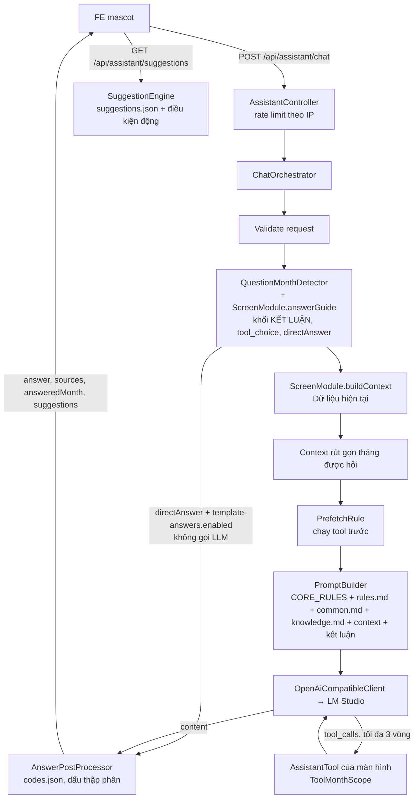

# Trợ lý AI (assistant) – backlog-be

Tài liệu kỹ thuật cho module trợ lý AI (mascot) trả lời câu hỏi theo màn hình FE. Hiện có: Cost Monitoring.
Quy ước ngắn cho AI coding agent: [CLAUDE.md](../../CLAUDE.md).

## Mục lục

1. [Tổng quan](#1-tổng-quan)
2. [Hạ tầng LLM](#2-hạ-tầng-llm)
3. [Cấu trúc thư mục](#3-cấu-trúc-thư-mục)
4. [Cách AI "biết" dữ liệu](#4-cách-ai-biết-dữ-liệu)
5. [Cost Monitoring](#5-cost-monitoring)
6. [API](#6-api)
7. [Hậu xử lý câu trả lời](#7-hậu-xử-lý-câu-trả-lời)
8. [Hướng dẫn thêm màn hình mới](#8-hướng-dẫn-thêm-màn-hình-mới)
9. [Sửa hành vi AI không cần sửa code](#9-sửa-hành-vi-ai-không-cần-sửa-code)
10. [Kiểm tra chất lượng](#10-kiểm-tra-chất-lượng)
11. [Giới hạn hiện tại](#11-giới-hạn-hiện-tại)
12. [Lịch sử thay đổi](#12-lịch-sử-thay-đổi)

---

## 1. Tổng quan

- FE gửi câu hỏi kèm `screenKey` (màn hình đang mở) và tham số màn hình. BE dựng context từ dữ liệu thật,
  gọi LLM nội bộ (LM Studio, API OpenAI-compatible) có tool calling, hậu xử lý rồi trả câu trả lời.
- Tách **lõi** (`assistant/core`, không chứa từ khóa nghiệp vụ) và **màn hình** (`assistant/screens/*` +
  `resources/assistant/screens/{screenKey}`). Màn hình đăng ký qua interface `ScreenModule`; `ScreenRegistry` tự gom các bean.
- Kết luận (vượt / trong target, tiến độ, dự báo, rủi ro…) **tính bằng code** (lớp `*Assessment`), model chỉ diễn đạt lại.
  Kết quả tool dạng `Nhãn=giá trị`, nhãn theo ngôn ngữ, không lộ mã nội bộ.
- Ngôn ngữ trả lời: `vi` (mặc định) hoặc `en`.
- Câu hỏi model nhỏ hay trả lời sai dù đã có dữ liệu: màn hình trả `AnswerGuide` (`ScreenModule.answerGuide`) –
  khối kết luận code tính sẵn, đặt cuối user message ngay trước "Câu hỏi:", và cờ `toolsSufficient`: nếu mọi tool
  pre-fetch ra kết quả thì gọi LLM với `tool_choice: "none"` (vẫn gửi tools để giữ prefix KV cache). Server vẫn trả
  `tool_calls` thì không chạy; content rỗng thì gọi lại 1 lần không gửi tools. Bỏ qua khi câu hỏi nhắc tháng khác
  tháng đang xem. (LM Studio có tôn trọng `tool_choice: "none"` với gpt-oss hay không: cần xác nhận qua audit log.)
- **Câu trả lời template (không gọi LLM)**: với loại câu hỏi mà kết luận tính sẵn đã trả lời trọn, màn hình trả thêm
  `AnswerGuide.directAnswer` (markdown do code render) + `suggestions`. `assistant.template-answers.enabled = true`
  (mặc định) → `ChatOrchestrator` trả luôn câu này (qua `AnswerPostProcessor`), không dựng context, không pre-fetch,
  không gọi LLM, không giữ suất `LlmConcurrencyLimiter`; audit `answerSource = "template"`, `llmCallCount = 0`.
  Lý do: gpt-oss-20b (low) vẫn trả lời "không có bất thường" dù khối KẾT LUẬN ghi 4 khung dự báo vượt.
  Các câu hỏi khác (nguyên nhân, khái niệm, vật tư, theo ngày…) giữ luồng LLM.



## 2. Hạ tầng LLM

**LM Studio** (máy chủ nội bộ, API OpenAI-compatible, không dùng API key):

| Thiết lập | Giá trị | Ghi chú |
|---|---|---|
| Model | `openai/gpt-oss-20b` | Mặc định trong `AssistantProperties` |
| Context Length | 16384 | Prompt + lịch sử + kết quả tool + câu trả lời phải nằm trong giới hạn này |
| Idle TTL | (cần xác nhận) | Model bị unload khi rảnh lâu → lần gọi đầu chậm hơn |
| Parallel | (cần xác nhận) | Nên ≥ `assistant.llm.max-concurrent` để các câu hỏi đồng thời không phải xếp hàng trong LM Studio |

**Cấu hình `assistant.*`** (`application.properties`, lớp `AssistantProperties`). Khi sửa, chỉ thay đúng dòng `assistant.*`.

| Key | Ý nghĩa |
|---|---|
| `assistant.name` | Tên mascot (mặc định / trống → `Anh Vê`). Thay placeholder `{{assistantName}}` trong `common.md`, `knowledge.md`, `rules.md` khi khởi động; FE lấy qua `GET /api/assistant/config`. Ký tự có dấu viết `\uXXXX` (vd `Anh Vê`) |
| `assistant.llm.base-url` | URL API OpenAI-compatible, không có `/` cuối |
| `assistant.llm.model` | Tên model trên LM Studio |
| `assistant.llm.timeout-seconds` | Timeout đọc mỗi lần gọi LLM (mặc định 180; connect cố định 5 giây) |
| `assistant.llm.max-tokens` | Số token tối đa của câu trả lời, gồm cả token reasoning (mặc định 3000) |
| `assistant.llm.temperature` | Mặc định 0.2 |
| `assistant.llm.max-concurrent` | Số câu hỏi xử lý đồng thời (mặc định 4); vượt → 503 `LLM_BUSY` |
| `assistant.llm.reasoning-effort` | Có giá trị thì gửi `reasoning_effort`; trống (mặc định) → dùng dòng `Reasoning:` trong prompt |
| `assistant.llm.prompt-token-warn` | Prompt ước tính (trước khi gọi) hoặc `promptTokens` thực tế (mỗi lần gọi) vượt mức này → log WARN kèm `screenKey`, `intent` (mặc định 13000; Context Length model 16384) |
| `assistant.llm.chars-per-token` | Tỷ lệ ký tự / token để ước tính prompt (mặc định 3.0; chưa gồm mô tả tool) – hiệu chỉnh theo audit `promptChars` / `llmCalls[0].promptTokens` |
| `assistant.audit.enabled` | Ghi audit log JSONL cho `/api/assistant/chat` (mặc định `true`), xem [mục 10 – Audit log](#audit-log) |
| `assistant.audit.dir` | Thư mục file audit (mặc định `logs/assistant`, tương đối với thư mục chạy app) |
| `assistant.template-answers.enabled` | `true` (mặc định): câu hỏi có `AnswerGuide.directAnswer` trả câu trả lời template, không gọi LLM. `false`: mọi câu hỏi qua LLM (khối KẾT LUẬN vẫn chèn như trước) |

**Giới hạn khi chạy:**

- **Đồng thời**: `LlmConcurrencyLimiter` (Semaphore). Một câu hỏi giữ 1 suất cho cả vòng tool calling; đầy thì trả 503 ngay, không chờ.
- **Timeout tổng**: 170 giây cho một câu hỏi (mọi lần gọi LLM + tool). Còn dưới 1 giây thì dừng, trả 503 `LLM_ERROR`.
- **Rate limit**: `/chat` 10 request / 60 giây / IP (`remoteAddr`, không tin `X-Forwarded-For`), lưu trong bộ nhớ từng instance.
- **Tool calling**: tối đa 3 vòng.
- **Reasoning**: cố định `Reasoning: low` cho mọi câu hỏi (dòng này nằm cuối system prompt; đổi theo câu hỏi làm mất KV cache).
  Kết luận khó do code tính sẵn (`*Assessment`, `AnswerGuide`).
- **Prompt lớn**: ước tính (ký tự / `chars-per-token`) hoặc `promptTokens` thực tế > `prompt-token-warn` → log WARN
  `Assistant: prompt too large …` (không chặn request).
- HTTP client ép HTTP/1.1, không streaming; chỉ lấy `message.content`, bỏ phần reasoning / `<think>`.

## 3. Cấu trúc thư mục

```
src/main/java/com/example/backlogbe/assistant/
├── core/
│   ├── api/          AssistantController, AssistantExceptionHandler, AssistantRateLimiter, dto/
│   ├── chat/         ChatOrchestrator (luồng chính)
│   ├── llm/          LlmClient, OpenAiCompatibleClient, LlmConcurrencyLimiter, các Llm*Exception
│   ├── prompt/       PromptBuilder
│   ├── tool/         AssistantTool (interface tool)
│   ├── prefetch/     PrefetchRule (interface)
│   ├── postprocess/  AnswerPostProcessor
│   ├── suggestion/   SuggestionEngine, SuggestionCondition, SuggestionFile
│   ├── month/        QuestionMonthDetector, ToolMonthScope
│   ├── screen/       ScreenModule, ScreenRegistry, ParamSpec
│   ├── config/       AssistantProperties (assistant.name, assistant.llm.*)
│   └── eval/         AssistantEvalController, AssistantEvalService, EvalCase/Report/Result (profile dev)
└── screens/
    ├── costmonitoring/  CostMonitoringModule, ContextProvider, Assessment, Snapshot(+Loader), CmText,
    │                    5 tool, RatioTrendPrefetchRule, ExplainVariancePrefetchRule, DailySeriesPrefetchRule,
    │                    TopItemsPrefetchRule, AnswerGuide, AnswerTemplate, LookupAnswers (câu tra cứu template),
    │                    CostMonitoringQuestion (nhận diện khung trong câu hỏi), SuggestionConditions, ToolArgs,
    │                    dto/, repository/
    └── _template/       TemplateModule, TemplateContextProvider, ExampleTool (mẫu, không @Component)

src/main/resources/assistant/
├── core/common.md                 kiến thức chung, nối vào system prompt
└── screens/
    ├── <screenKey>/               vd cost-monitoring/: knowledge.md, rules.md, codes.json, suggestions.json, eval.json
    └── _template/                 mẫu + README.md mô tả từng file (không bao giờ được đọc khi chạy)
```

## 4. Cách AI "biết" dữ liệu

- **Không fine-tune.** Model dùng nguyên bản; mọi hiểu biết về màn hình đến từ prompt và tool ở mỗi câu hỏi.
- **Prompt** (`PromptBuilder`), xếp để tận dụng KV cache (prefix cache) của LM Studio:
  - System = **phần cố định**, giống nhau byte-by-byte giữa các request cùng `screenKey` + `lang`:
    chỉ định ngôn ngữ + quy tắc chung (CORE_RULES trong code) + `rules.md` + `core/common.md` + `knowledge.md`
    + chỉ định ngôn ngữ, cuối cùng là dòng `Reasoning: low` (cố định). Template gpt-oss đặt mô tả tool
    ngay sau system nên tool cũng thuộc prefix cố định.
  - History.
  - User (cuối) = **phần động**: `Dữ liệu hiện tại:` + context màn hình (ngày, snapshot, ô đang xem, tháng được hỏi,
    kết quả pre-fetch) + `Câu hỏi:` + câu hỏi (+ câu nhắc; `vi` thêm "(Trả lời bằng tiếng Việt.)").
  - Không đưa giá trị đổi theo request (ngày giờ, số liệu) vào system; mô tả / schema tool phải cố định.
  - KV cache chỉ dùng lại khi request trước chạy trên cùng slot; LM Studio đặt Parallel > 1 thì mỗi slot có cache riêng (cần xác nhận cấu hình server).
- **Context**: `ScreenModule.buildContext(params, lang)` lấy số liệu đúng như màn hình FE đang hiển thị.
- **Assessment tính sẵn kết luận**: vd `CostMonitoringAssessment` tính tiến độ, dự báo, rủi ro, kịch bản cuối tháng
  và đưa vào context/tool dưới dạng nhãn ("Kết luận dự báo=…", "Rủi ro=…"). Model không phải tự so sánh số.
- **Tool calling**: model gọi tool khi cần chi tiết (theo ngày, top vật tư, tháng trước…). Kết quả tool được giới hạn độ dài
  (`AssistantTool.maxResultLength`). Tool đã chạy thành công được trả về trong `sources`.
- **Prefetch**: `PrefetchRule` chạy tool trước khi gọi LLM cho loại câu hỏi đã biết (model nhỏ hay quên gọi tool;
  tránh 1 lần gọi LLM chỉ để sinh tool call), kết quả nối vào cuối context. `matches(question, screenKey, params)`
  nhận params màn hình (vd ô đang mở). Không pre-fetch được thì thêm câu nhắc model tự gọi tool.
- **Hỏi tháng khác** (màn hình có `supportsMonthQuestions() = true`):
  - `QuestionMonthDetector` dò tháng trong câu hỏi ("tháng 10", "T10/2026", "2026-10", "october 2026"…).
    `MonthPlan` chọn tối đa 2 tháng khác tháng đang xem, trong 24 tháng gần nhất, không vượt tháng hiện tại.
  - Mỗi tháng đó được nối thêm context rút gọn (`buildCompactContext`).
  - Tool có tham số tùy chọn `month`; `ToolMonthScope` chỉ cho phép tháng đang xem hoặc tháng đã dựng context,
    params đổi qua `ScreenModule.paramsForMonth`. Tháng khác → lỗi `invalid_argument` trả cho model.
  - Response có `answeredMonth` khi câu trả lời dùng dữ liệu tháng khác. Không dựng được (ngoài phạm vi) → câu nhắc người dùng đổi tháng.

## 5. Cost Monitoring

`screenKey = cost-monitoring`. Params: `month` (`yyyy-MM` | `yyyy.MM`, trống = tháng hiện tại),
`simuWeek` / `plTgtMode` (`Simu_W1..Simu_W5`, trống = tuần mới nhất có số), `factory` + `category` (tùy chọn – ô đang
mở khi FE mở chat từ drawer: `PRESS|MOLD|GUIDE` (nhận cả `PR|MO|GU`) × `OT|T&SL|RM` (nhận cả `TSL`)). Lưới 3×3: bộ phận
PRESS / MOLD / GUIDE × loại chi phí OT / T&SL / RM; mỗi ô là một "khung".

Có `factory` + `category` hợp lệ (`CostMonitoringFocus`): context thêm dòng "Ô đang xem (mở từ drawer)…", và tool nào model
bỏ trống `div` / `cost` thì lấy theo ô này (`CostMonitoringToolArgs`). Thiếu / sai → chat chạy như cũ.

### Nguồn dữ liệu

| Nguồn | Dùng cho |
|---|---|
| `sp_CostMonitoringChart` | Dữ liệu chart theo ngày: FC, PL, Fluct (`fluctTgt`), Actual MTD, Estimate (`Est_MTD`) |
| `fn_CostActualDaily` | Actual theo ngày, gồm phân bổ chi phí chung (`sql/02_fn_cost_actual_daily.sql`); `sp_CostMonitoringChart` gọi hàm này. `CostTopItemsRepository` không gọi hàm mà lặp lại cùng bộ lọc trên `CostTool` / `CostRm`, chỉ lấy cost center trực tiếp |
| `F2_PL_TGT` | PL simulation theo tuần (`Simu_W1..W5`) |
| `F2_Working_Date` | Lịch làm việc (`WD_All`, `WD_Office`), Ratio theo ngày (`Adj_Ratio_PR/_MO/_GU`, `Adj_Ratio_KVH`) |
| `CostTool` | Chi tiết xuất vật tư T&SL (vật tư, cost center, máy) |
| `CostRm` | Chi tiết xuất vật tư RM |

**Cache snapshot** (`CostMonitoringSnapshotLoader`): kết quả `sp_CostMonitoringChart` (snapshot) được cache trong bộ nhớ theo
(month, simuWeek, ngày hôm nay), dùng chung cho context / tool trợ lý, `GET /api/cost-monitoring/chart` và `/detail`
→ 3 nơi cùng số. TTL `cost-monitoring.snapshot-cache-ttl-seconds` (mặc định 180; ≤ 0 = tắt), nên số liệu mới trong DB
có thể trễ tối đa bằng TTL. `refresh=true` trên `/chart` hoặc `/detail` bỏ qua cache, load lại và ghi đè cache
(trợ lý dùng luôn số mới). Mỗi instance có cache riêng; lỗi không được cache.

**Context thu gọn**: câu hỏi xác định được đúng 1 khung (`CostMonitoringQuestion.frame`: 1 bộ phận + 1 loại chi phí
trong câu hỏi, phần thiếu lấy từ ô drawer) → context chỉ có dòng của khung đó + Ratio bộ phận đó, thay 5 dòng tổng hợp
bằng 1 dòng ghi chú "khung khác: gọi explain_variance". Câu hỏi chung / nhiều khung → context đầy đủ. Câu hỏi có ý hỏi
khung khác ("khung khác", "khung nào", "các khung", "tất cả (các) khung / bộ phận / loại (chi phí)", en "other frames",
"all frames / divisions / cost types", "which" trừ "which day") cũng coi là câu hỏi chung (đủ context, không pre-fetch theo
khung; câu hỏi dự báo vẫn pre-fetch explain_variance). "tất cả" đi với từ khác (vd "tất cả vật tư của PRESS T&SL") vẫn là
câu hỏi 1 khung. Câu nối tiếp "còn … thì sao": chỉ xét phần "…" + ô drawer cho phần thiếu; ghép được đúng 1 khung
(vd drawer PRESS T&SL + "còn RM thì sao?" → PRESS RM) thì là câu hỏi 1 khung đó, không thì câu hỏi chung.
Ước lượng: ~2.6k → ~0.4k token (mẫu tháng đang diễn ra, 9 khung).

### Công thức

D = ngày dữ liệu hiện tại, N = số ngày trong tháng.

- **Fluct** (Fluctuating TGT, target chính) = FC × (1 + Ratio).
- **Ratio** = (Sale&Inven +/-) / Doanh số FC cả tháng của bộ phận;
  Sale&Inven +/- = (Doanh số thực tế MTD − Doanh số FC MTD) + (Tồn kho hiện tại − Tồn kho đầu tháng).
  Cùng một Ratio cho OT, T&SL, RM của một bộ phận. Ngày chưa tới dùng Ratio của hôm qua.
- **Estimate** (`Est_MTD`) = Actual cuối + phần COALESCE(PL, FC) các ngày còn lại, phân bổ theo `WD_All` (ngày nghỉ nhà máy không cộng);
  bắt đầu từ ngày có Actual cuối (= Actual ngày đó). Chưa có Actual (vd OT) thì không có Estimate (hiển thị "-").
  PL trống mà có Estimate → ghi chú "(theo FC)".
- **Badge** = Actual / Fluct × 100 ("OK x%" / "Vượt x%"). **Tiến độ chuẩn** = D / N × 100.
- **Dự báo cuối tháng**: có Estimate → Estimate ngày cuối tháng (cơ sở "theo PL" hoặc "theo FC");
  không có Estimate → Actual + Fluct / N × (N − D). Dự báo > Fluct ngày cuối tháng → "Dự báo vượt Fluct".
- **Rủi ro**: HIGH khi đã vượt hoặc dự báo vượt; WATCH khi chi nhanh hơn tiến độ (> 3 điểm %) nhưng dự báo trong Fluct; còn lại OK.
- **Kịch bản cuối tháng**:
  "Nếu từ nay chi đúng target" = Actual + Fluct / N × (N − D);
  "Nếu giữ tốc độ hiện tại" = **projectedEom** (dự báo cuối tháng theo tốc độ chi hiện tại) = Actual / Dk × N,
  Dk = ngày có actual mới nhất của chính khung (RM thường trễ T&SL 1 ngày); **projectedOver** = projectedEom − Fluct
  (thêm projectedEom − FC). Câu hỏi "cứ chi như vậy / dự báo / cuối tháng" trả lời theo số này (rules.md);
  "Ngân sách còn lại mỗi ngày" = (Fluct − Actual) / (N − D); "Nhịp target mỗi ngày" = Fluct / N.
- Tháng đã kết thúc: không tính tiến độ / dự báo / kịch bản; thay bằng "Kết quả tháng" = Actual − Fluct.
- Mọi phần chênh hiển thị tính từ số đã làm tròn 1 chữ số (K$), để khớp phép trừ người dùng tự làm trên màn hình.

Chi tiết: comment đầu `CostMonitoringAssessment` và `knowledge.md`.

### Tool

Thứ tự gửi cho LLM giữ như bảng. Mọi tool có tham số tùy chọn `month`.

| Tool | Tham số | Trả về (tóm tắt) |
|---|---|---|
| `get_daily_series` | `div`, `cost` | Chuỗi theo ngày từ ngày 1 đến D: ngày nghỉ, chi trong ngày, Actual cộng dồn, Fluct trong ngày, Fluct theo tiến độ, % đã dùng, % thời gian. Dòng đối chiếu: Σ chi trong ngày = Actual cộng dồn mới nhất, kèm ngày âm. |
| `get_top_items` | `div`, `cost` (T&SL, RM), `limit` | Top vật tư, top cost center, top máy (K$ 2 chữ số, % của Actual) + dòng "Tổng top N" mỗi danh sách (K$ cộng từ số đã làm tròn, % của Actual) + tổng; chỉ cost center trực tiếp, chưa gồm phân bổ. Chuỗi dữ liệu qua `CmText.clean` (gộp khoảng trắng: "PR   CT   CT2" → "PR CT CT2"). |
| `compare_previous_month` | `div`, `cost` | Tháng trước: FC, Fluct, Act cuối tháng, Act cùng kỳ (ngày D), kèm số tháng này. |
| `explain_variance` | `div` (thêm `ALL`), `cost` | Giải thích chênh lệch, tính sẵn: chế độ IN_PROGRESS / OVER / CLOSED_WITHIN, tiến độ, dự báo, rủi ro, dự báo theo tốc độ chi hiện tại (projectedEom / projectedOver so với Fluct, FC, "Dự báo bằng % Fluct" = projectedEom / Fluct từ số làm tròn 1 chữ số), `ALL`: dòng xếp hạng bộ phận theo % đó, kịch bản, top ngày / vật tư, so cùng kỳ (RM, T&SL). |
| `get_ratio_trend` | `div` | Ratio theo ngày (bộ phận + KVH), Fluct theo ngày, tóm tắt đầu / cuối, ngày đổi chiều, ngày tăng / giảm mạnh nhất. |

Pre-fetch: `RatioTrendPrefetchRule` chạy `get_ratio_trend` khi câu hỏi về xu hướng Fluct ("fluct" + vì sao / tăng / giảm…);
`div` rút từ câu hỏi, không nhắc bộ phận → chạy cả PRESS, MOLD, GUIDE.
**Phân loại intent** (`CostMonitoringIntentClassifier`): câu hỏi được chuẩn hóa (chữ thường, bỏ dấu tiếng Việt, `đ` → `d`,
gộp khoảng trắng: "bô phận" = "bộ phận" = "bo phan"), từ khóa viết không dấu, khớp nguyên từ. Bỏ qua câu hỏi khái niệm
("là gì / cách tính") và câu hỏi xu hướng Fluct.

| Intent | Khớp khi | Ghi chú |
|---|---|---|
| `why` | "vì sao", "tại sao", "nguyên nhân", "lý do", "do đâu", why, cause, reason | Cần xác định được đúng 1 khung; không thì xét intent kế tiếp |
| `compare` | ≥ 2 bộ phận, hoặc 1 bộ phận + ≥ 2 loại chi phí; hoặc "so sánh", "vs", "versus", "với", "chart nào", "bên nào", "tốt hơn", "tệ hơn", compare, better, worse | Bỏ qua khi nhắc tháng trước / cùng kỳ (`compare_previous_month` lo) |
| `ranking` | "nhất" (trừ "cập nhật"), "xếp hạng", rank, most, highest, worst | Bỏ qua khi hỏi vật tư / máy / cost center / Category hoặc theo ngày |
| `forecast_one` / `forecast_all` (+ `_current_rate`) | "cuối tháng", "dự báo", "cứ chi", "giữ tốc độ", "sẽ vượt", "(có) vượt … không / ko / chưa", forecast… | 1 bộ phận (câu hỏi / ô drawer) → `forecast_one`; còn lại `forecast_all` |
| `overview` | "bất thường", "cần theo dõi", "cần chú ý", "đáng lo", abnormal… | Không nêu đúng 1 bộ phận, không hỏi ô drawer, không nhắc tháng trước |

- Thứ tự ưu tiên: `why` > `compare` > `ranking` > `forecast` > `overview`. Không khớp intent nào → **không** mặc định
  overview: câu phân tích đúng 1 khung ("đánh giá", "phân tích", "rủi ro", "tình hình", "thế nào", "sao", "ổn không"…)
  hoặc câu hỏi từ drawer (trừ câu theo ngày) → `frame`; còn lại không pre-fetch, không khối KẾT LUẬN.
- **Template chỉ khi khớp CHẮC CHẮN** (`Result.certain`): có intent, không có từ "đánh giá", "so sánh", "tốt", "nên",
  "tại sao / vì sao", và chỉ khớp 1 intent trong `why` / `compare` / `ranking` / `forecast` (`overview` không tính là khớp
  thêm: "bất thường nhất" = xếp hạng). Khớp nhiều intent / có từ không chắc chắn → LLM (vẫn có khối KẾT LUẬN theo intent chính).
- Audit `intentMatch`: vd `primary=ranking; matched=ranking(nhat), overview(bat thuong); uncertain=-; template=yes`
  (thêm `ignored=…` khi tín hiệu bị bỏ, vd ranking vì hỏi vật tư).

`ExplainVariancePrefetchRule` chạy `explain_variance` theo intent:
- `forecast_*`: div / cost từ câu hỏi, thiếu thì theo ô drawer; vẫn thiếu div (hoặc ≥ 2 bộ phận) → `ALL` chế độ tóm tắt;
  thiếu cost → T&SL và RM (mỗi cost 1 lần gọi).
- `ranking`, `overview`: `div=ALL` chế độ tóm tắt (tham số ẩn `summary=true`, không khai báo trong schema gửi model: mỗi khung
  1 dòng FC / Fluct / Actual / cuối tháng / % Fluct / chênh Fluct, FC + dòng xếp hạng gọn; ≤ 1200 ký tự mỗi loại chi phí,
  tổng ≈ 1.5k token), cost từ câu hỏi, thiếu → T&SL và RM.
- `compare`: khung = bộ phận (câu hỏi → ô drawer → cả 3) × loại chi phí (câu hỏi → ô drawer → T&SL, RM); ≤ 2 khung → mỗi
  khung 1 lần gọi bản đầy đủ; nhiều hơn → `div=ALL` tóm tắt.
- `why`, `frame`: 1 lần gọi cho khung đó (phần thiếu lấy từ ô drawer).

**"Dự báo vượt" – 2 cách** (`CostMonitoringAssessment`, dùng chung trợ lý / `/chart` / `/suggestions`):

| | Field | Cách tính | Dùng khi |
|---|---|---|---|
| CHÍNH | `estimateEom`, `estimateOver`, `estimateOverFc`, `estimatePctOfFluct`, `estimateOverPct`, `estimateBase` | PL Estimate (`estMonthEnd`); không có PL thì Act + Fluct / N × (N − D) (= `forecast`) | Mọi câu dự báo / bất thường / xếp hạng; banner, greeting, `/chart` `status` |
| PHỤ | `projectedEom`, `projectedOver`, `projectedOverFc`, `projectedPctOfFluct`, `projectedOverPct` | Tốc độ chi hiện tại: Act / ngày có actual × N | Chỉ câu "cứ chi như vậy / giữ tốc độ" (`Plan.atCurrentRate`), luôn ghi "theo tốc độ chi hiện tại" |

Trạng thái chính (`CostChartForecasts.status`): `OVER` (Act > Fluct) → `WILL_EXCEED` (estimate > Fluct) → `WITHIN` / `NO_DATA`.
`projectionsDisagree()`: 2 cách trái chiều so với Fluct → context / KẾT LUẬN thêm ghi chú "theo tốc độ chi hiện tại thì …".
Mọi phần chênh / % từ số làm tròn 1 chữ số; "Vượt Fluct %" = % Fluct (1 chữ số) − 100.

`CostMonitoringAnswerGuide` (`AnswerGuide`, loại câu hỏi theo `ExplainVariancePrefetchRule.plan`; khối "[KẾT LUẬN …]" chỉ
ghi nhóm CÓ khung, mọi nhóm rỗng → 1 dòng khẳng định):
- Tổng quan / bất thường (`overview`), dự báo chung `div=ALL` (`forecast_all`): theo dự báo CHÍNH – dự báo vượt
  Fluct (chưa vượt thực tế), dự báo vượt FC nhưng trong Fluct, đã vượt thực tế, khung chỉ vượt theo tốc độ chi hiện tại
  (tham khảo). Mỗi khung 1 dòng `CmText.estimateBrief`, sắp theo % Fluct giảm dần (`BY_ESTIMATE_PCT_DESC`).
  Câu "cứ chi như vậy" (`forecast_all_current_rate`): nhóm theo tốc độ chi hiện tại (`CmText.projectedBrief`).
- So sánh (`compare`, luôn qua LLM): khối "[KẾT LUẬN – so sánh …]" cho đúng các khung được hỏi, mỗi khung 1 dòng: % đã
  dùng (Actual / Fluct), tiến độ (+ so với tiến độ K$), dự báo chính so với Fluct và FC (K$ và %), rủi ro; dòng
  "Khung tốt hơn theo dự báo chính = …" (% Fluct dự báo thấp hơn là tốt hơn; chênh < 1 điểm % → "tương đương"; tháng đã
  kết thúc theo Actual / Fluct). Chỉ thị: chỉ nói về các khung trên. Hỏi vật tư / máy… → vẫn cho gọi tool.
- "… nhất" / "xếp hạng" (`ranking`): xếp hạng theo % Fluct dự báo chính + "Dự báo vượt Fluct nhiều nhất theo K$"
  + khung đã vượt (tháng đã kết thúc: Actual / Fluct). Câu hỏi nêu vật tư / máy / cost center / Category: vẫn cho gọi tool.
- Dự báo 1 khung (`forecast_one`, `forecast_one_current_rate`): 1 dòng mỗi khung được hỏi theo cách tương ứng; cấm gọi thêm tool;
  chỉ thị kèm cụm bắt buộc chép nguyên văn cho CẢ Fluct và FC (vd «MOLD T&SL: vượt Fluct +23.5 K$ (+30.1%); vượt FC +18.3 K$»).
- Tổng quan / dự báo chung: chỉ thị kèm câu mở đầu cố định do code đếm (vd "Có 4 khung dự báo vượt Fluct (theo nhịp Fluct,
  chưa có PL):"); nhãn cơ sở theo `estimateBase` thực tế (PL / nhịp Fluct / trộn).
- "Vì sao / tại sao / nguyên nhân" về 1 khung (`why`, từ nhánh phân tích 1 khung / drawer): khối "[KẾT LUẬN – nguyên nhân …]"
  gồm chế độ, Chi vượt tiến độ (hoặc Phần vượt Fluct = Target bị hạ + Chi vượt FC), Fluct so với FC đúng chiều (Ratio dương
  = target được nâng, giảm khả năng vượt, không phải nguyên nhân); vẫn cho gọi tool.
- Cuối khối: dòng chỉ thị (dựa ĐÚNG KẾT LUẬN, "hôm nay" = tháng đến ngày có actual mới nhất, % ghi "(+25.3%)" / "bằng
  125.3% Fluct", câu tổng quan trả lời ngắn mỗi khung 1 dòng); có khung dự báo / đã vượt thì cấm "không có bất thường".
- "Vì sao …" xác định được đúng 1 khung luôn là `why`, kể cả câu có từ dự báo ("Vì sao PRESS T&SL dự báo vượt?").
- `frame` / không khớp intent: không khối KẾT LUẬN, chỉ ghi `intentMatch` vào audit.

**Câu trả lời template** (`CostMonitoringAnswerTemplate`, `AnswerGuide.directAnswer`, không gọi LLM) cho `overview`,
`ranking`, `forecast_all`, `forecast_one` (+ `_current_rate`). Cùng danh sách khung / số / thứ tự với khối KẾT LUẬN
(`CostMonitoringAnswerGuide.frames`):
- Tổng quan / dự báo chung: câu mở đầu đếm số khung (`openingSentence`, vd "Có 4 khung dự báo vượt Fluct (theo PL), 1 khung
  đã vượt Fluct thực tế:"), mỗi nhóm có khung: tiêu đề **đậm** ngắn, không viết hoa ("Dự báo vượt Fluct", "Dự báo vượt FC
  nhưng trong Fluct", "Theo tốc độ hiện tại thì vượt (tham khảo)", "Đã vượt Fluct (thực tế)") + mỗi khung 1 dòng như
  KẾT LUẬN; nhóm rỗng bỏ; không có khung nào → 1 câu khẳng định ("Không khung nào dự báo cuối tháng vượt Fluct hay FC.").
  Khối KẾT LUẬN (gửi LLM) vẫn giữ tiêu đề cũ có chữ in hoa để nhấn mạnh.
- Xếp hạng: câu đầu = khung đứng đầu theo % Fluct (+ khung vượt nhiều nhất theo K$ nếu khác), danh sách đánh số, nhóm đã vượt.
- Dự báo 1 bộ phận: câu đầu = kết luận từng khung (vượt Fluct / vượt FC nhưng trong Fluct / trong cả 2), rồi mỗi khung 1 dòng
  nêu cả Fluct và FC (câu "cứ chi như vậy": kèm tốc độ K$/ngày).
- Tháng đã kết thúc: theo kết quả tháng (Actual so với Fluct / FC).
- Dòng cuối (nghiêng): "Số liệu tháng …, actual đến ngày …; <cơ sở>" – cơ sở theo `estimateBase` của các khung: mọi khung
  chưa có PL → "chưa có PL nên dự báo theo nhịp Fluct"; mọi khung có PL → "dự báo theo PL"; trộn → "dự báo theo PL; khung
  chưa có PL theo nhịp Fluct"; câu "cứ chi như vậy" → "dự báo theo tốc độ chi hiện tại".
- `suggestions` (tối đa 3, `kind = "dynamic"`): "Vì sao X vượt target?" / "Vì sao X dự báo vượt?" cho khung nổi bật,
  "Cứ chi như vậy thì X có vượt FC không?" (dự báo 1 bộ phận), "Vật tư nào chi nhiều nhất ở X?".
- Không dùng template (vẫn qua LLM, có khối KẾT LUẬN) khi (`templateEligible`): phân loại không chắc chắn (xem bảng intent),
  nêu vật tư / máy / cost center / Category, hỏi theo ngày, so với tháng trước / cùng kỳ, dự báo 1 bộ phận kèm hỏi khung
  khác (`asksOtherFrames`), hoặc không tìm thấy khung nào.

**Câu trả lời tra cứu** (`CostMonitoringLookupAnswers`, template, không gọi LLM): chạy TRƯỚC phân loại intent trong
`CostMonitoringAnswerGuide.guide`; không khớp / lỗi đọc dữ liệu → luồng intent như trên. Bỏ qua câu hỏi nguyên nhân,
so sánh, tháng trước / cùng kỳ. Khung: `CostMonitoringQuestion.frame` (câu hỏi + ô drawer); không ra đúng 1 khung → bộ
phận nêu trong câu (hoặc cả 3) × loại chi phí nêu trong câu (hoặc T&SL, RM); OT bỏ. Truy vấn DB từng khung chạy song song.

| Intent (audit `answerIntent`) | Khớp khi | Trả lời |
|---|---|---|
| `top_detail` | máy / cost center / Category ("loại vật tư", "nhóm vật tư") + "nhất / top / lớn / nhiều / tốn…"; không hỏi theo ngày. "máy" nhận theo câu có dấu (không nhầm "mấy") hoặc "máy nào / top máy / machine" | Mỗi khung xếp riêng (không cộng T&SL với RM): 1 khung → top 5; 2–3 khung → top 3 mỗi khung; nhiều hơn → top 1 mỗi khung. Máy chỉ T&SL (RM không ghi Machine; hỏi máy của RM → báo không có dữ liệu). Category = tổng thật theo Category (`sumByCategory`), không cộng từ top vật tư. Audit `intentMatch` có `dim=machine\|cost_center\|category` |
| `top_item` | vật tư + "nhất / top / lớn / chính / mắc / đắt…"; không hỏi máy / cost center / Category / theo ngày | 1 khung → top 5 vật tư; nhiều khung → vật tư lớn nhất mỗi khung + vật tư lớn nhất chung. "mắc / đắt / expensive": thêm số lượng + đơn giá TB = tổng chi / số lượng, ghi rõ xếp theo tổng chi |
| `top_day` | "ngày nào / hôm nào" + "nhiều / cao / lớn nhất"; không hỏi vật tư / máy… | Ngày chi lớn nhất (+ 2 ngày kế tiếp nếu 1 khung), % Actual đến nay |
| `remaining_budget` | "còn lại / tối đa / được chi / ngân sách" + "mỗi ngày / 1 ngày / per day" | (Fluct − Actual) / ngày lịch còn lại (N − D) và / ngày nhà máy làm việc còn lại (Σ `WD_All` từ D + 1), so với tốc độ chi hiện tại → "cần giảm X%". Tháng đã kết thúc → không áp dụng |
| `anomaly_today` | "bất thường / đột biến / spike" + "hôm nay / hôm qua / mới nhất / gần nhất / today / latest" | Ngày có dữ liệu mới nhất; mỗi khung: ngày có chi gần nhất so với TB các ngày có chi khác (đột biến: ≥ 2 lần và ≥ 1.0 K$) + khoản ≥ 10% Actual trong ngày đó. Ghép thêm template tổng quan tháng dạng gọn (`compactOverview`: câu tóm tắt + nhóm đầu + footer) → intent `overview+anomaly_today` |

Khoảng ngày truy vấn vật tư / máy / cost center giống `get_top_items`: đầu tháng → T&SL hôm qua, RM hôm kia.
Lookup trả `toolsSufficient = false`: tắt `template-answers` thì LLM vẫn tự gọi tool.

`TopItemsPrefetchRule` (luồng LLM, khi tắt template hoặc lookup không trả lời được): câu hỏi vật tư / máy / cost center /
Category, không hỏi nguyên nhân / so sánh / theo ngày, xác định được khung (1 khung, hoặc 1 bộ phận không nêu loại chi phí →
T&SL + RM) → pre-fetch `get_top_items`, intent `top_items_prefetch`, `tool_choice: "none"` (1 lần gọi LLM thay vì 2).

`DailySeriesPrefetchRule` chạy `get_daily_series` cho câu hỏi theo ngày ("ngày nào", "hôm nào", "theo ngày", "từng ngày",
"đột biến", "ngày 25" / "25/10", "chi nhiều / ít nhất" không hỏi vật tư / cost center / máy) khi xác định được đúng 1 khung
(câu hỏi hoặc ô drawer); bỏ qua OT và câu hỏi khái niệm.

### Điều kiện gợi ý động (`CostMonitoringSuggestionConditions`)

| `when` | Điều kiện | Ưu tiên |
|---|---|---|
| `over` | Actual > Fluct | tier 0, weight = Actual − Fluct |
| `forecast_over` | Chưa vượt, dự báo cuối tháng > Fluct | tier 1, weight = phần dự báo vượt |
| `watch` | Rủi ro "Cần theo dõi" | tier 2, weight = Pct − Pace |
| `no_actual` | Khung chưa có Actual | tier 3 |
| `no_pl` | Tháng chưa có PL simulation (không có `{div}` / `{cost}`) | tier 3 |
| `fluct_below_fc` / `fluct_above_fc` | \|Fluct / FC − 1\| ≥ 3% (chỉ `{div}`) | tier 3, weight = \|Fluct / FC − 1\| |

Tối đa 2 câu động, mỗi khung tối đa 1 câu; phần còn lại là câu tĩnh. Greeting đếm số khung `over` / `forecast_over`.

## 6. API

Không yêu cầu token (giống các API hiện có), `@CrossOrigin(*)`.

### `GET /api/cost-monitoring/chart`

Tham số: `month`, `simuWeek`, `refresh` (mặc định `false`; `true` = bỏ qua cache snapshot, load lại và ghi đè cache).
Đọc qua cache snapshot dùng chung (xem mục 5 – Cache snapshot).
Mỗi `charts[i]` có thêm `forecast` (`CostChartForecastDto`, do `CostChartForecasts.withForecasts` gắn, không lưu trong cache)
để FE dùng thay vì tự tính banner / badge:

| Field | Ý nghĩa |
|---|---|
| `status` | `OVER` (Actual > Fluct) / `WILL_EXCEED` (chưa vượt, dự báo chính > Fluct) / `WITHIN` / `NO_DATA`; tháng đã kết thúc: `OVER` / `WITHIN`. Banner "N khung dự báo vượt" = số `WILL_EXCEED` (giống greeting `/suggestions`) |
| `actualPctOfFluct` | Actual / Fluct × 100 (badge, chưa làm tròn) |
| `estimateBase`, `estimateEom`, `estimateOver`, `estimateOverFc`, `estimatePctOfFluct`, `estimateOverPct` | Dự báo CHÍNH (PL Estimate; không PL thì theo nhịp Fluct), K$ / % |
| `projectedEom`, `projectedOver`, `projectedOverFc`, `projectedPctOfFluct`, `projectedOverPct` | Dự báo PHỤ theo tốc độ chi hiện tại (hiển thị phải ghi rõ) |

Field cũ giữ nguyên (thêm field, không phá hợp đồng). Tháng đã kết thúc: các field dự báo = `null`.

### `GET /api/cost-monitoring/detail` (drawer 1 ô, không thuộc trợ lý nhưng dùng chung tính toán)

Tham số: `div` (PR|MO|Guide), `chart` (OT|T&SL|RM; URL-encode `T%26SL`) – cùng mã với `/chart`, response trả lại `div` / `chart` cùng mã, `month` (yyyy-MM, trống = tháng hiện tại),
`simuWeek`, `date` (yyyy-MM-dd trong tháng, chỉ lọc transactions), `page` (0-based), `size` (1..200, mặc định 50),
`refresh` (như `/chart`).
Sai / thiếu → 400 `{status, message}`, vd "div must be one of PR, MO, Guide." / "chart must be one of OT, T&SL, RM."

- `kpi`: `fc`, `fluct`, `ratioPct`, `actMtd`, `estimateEom` (null → FE hiển thị "-"), `estimateNote` ("(theo FC)" khi PL trống
  mà có Estimate, tháng đang diễn ra; còn lại null), `pctOfFluct`, `currentRate`, `projectedEom`, `projectedOver`
  (so Fluct), `projectedOverFc`, `status` (OVER | OK | null khi chưa có Actual). Tháng đã kết thúc: `projectedEom` = Actual.
- `daily`: ngày 1 → `asOfDate` (ngày có actual mới nhất của ô): `date`, `daily`, `cumulative`, `ratioPct`, `fluct`,
  `diff` (= cumulative − fluct). `daily` = chênh cumulative trên số 1 chữ số → Σ daily = `kpi.actMtd`.
- `transactions`: `CostTool` (T&SL) / `CostRm` (RM), cùng bộ lọc `fn_CostActualDaily`, chỉ cost center trực tiếp của bộ phận;
  kỳ = ngày 1 → `asOfDate` (hoặc đúng `date`); sort thành tiền giảm dần; `totalElements`, `totalPages`, `totalAmountK`,
  `allocationK` (= Actual − tổng trực tiếp: phân bổ F2 / HT2 / HT-G + điều chỉnh). Mỗi dòng: `date`, `code`, `name`, `category`,
  `qty`, `qtyUnit`, `unitPrice`, `amount` ($), `amountK`, `costCenter`, `costCenterName`, `machine`.
- OT: chỉ KPI FC / Fluct / Ratio; `daily`, `transactions` rỗng.

### `GET /api/cost-monitoring/detail/transactions` (nhẹ, không chạy snapshot / SP)

Tham số: `div`, `chart` (như `/detail`), `from`, `to` (yyyy-MM-dd, bắt buộc, `from <= to`, cùng 1 tháng), `page`, `size` (như `/detail`).
Trả đúng shape `transactions` của `/detail` (cùng lõi `loadTransactionPage`), `allocationK` luôn `null` (không có Actual). OT → trang rỗng.

### `GET /api/cost-monitoring/detail/transactions/export`

Cùng tham số (không `page` / `size`) → file `.xlsx` (`cost_transactions_{div}_{chart}_{yyyyMMdd}-{yyyyMMdd}.xlsx`, `T&SL` → `TSL`).
Phần đầu: Div, Chart, Period, Unit, Scope, Rows, Total (K$), Exported at; bảng cùng cột với drawer, sort thành tiền giảm dần.
Validate + đếm dòng trước khi stream (lỗi → 400 JSON); quá 50 000 dòng → 400, yêu cầu thu hẹp khoảng ngày. SXSSF, đọc DB từng dòng.

### `POST /api/assistant/chat`

```json
{
  "screenKey": "cost-monitoring",
  "params": { "month": "2026-11", "simuWeek": "Simu_W2", "factory": "PRESS", "category": "T&SL" },
  "question": "Vì sao PRESS RM vượt target?",
  "history": [ { "role": "user", "content": "..." }, { "role": "assistant", "content": "..." } ],
  "lang": "vi"
}
```

```json
{
  "answer": "...",
  "sources": [ { "tool": "explain_variance", "div": "PRESS", "cost": "RM", "month": "2026-11" } ],
  "answeredMonth": "2026-10",
  "suggestions": [ { "text": "Vì sao PRESS T&SL dự báo vượt?", "kind": "dynamic" } ]
}
```

- Giới hạn: câu hỏi ≤ 2000 ký tự; `history` giữ 6 lượt cuối, mỗi lượt ≤ 4000 ký tự; ≤ 20 params, mỗi giá trị ≤ 100 ký tự;
  `screenKey` dạng `^[a-z0-9-]{1,50}$`; `lang` = `vi` | `en`.
- `sources`: tool đã gọi thành công, không trùng (khác `month` = phần tử khác), theo thứ tự gọi (pre-fetch trước).
- `answeredMonth`: chỉ có khi câu trả lời dùng dữ liệu tháng khác tháng đang xem.
- `suggestions`: câu hỏi gợi ý tiếp theo (cùng shape `/suggestions`); hiện chỉ có ở câu trả lời template
  (`answerSource = "template"`), rỗng → bỏ khỏi JSON; câu trả lời template có `sources: []`.
  FE hiển thị field này: cần xác nhận phía FE.

### `GET /api/assistant/suggestions`

`?screenKey=cost-monitoring&month=2026-11&lang=vi&count=4&exclude=...&exclude=...`

```json
{
  "greeting": "...",
  "suggestions": [ { "text": "Vì sao PRESS RM vượt target?", "kind": "dynamic" }, { "text": "...", "kind": "static" } ]
}
```

Không gọi LLM, không rate limit. Tham số màn hình lấy đúng theo `ScreenModule.paramSpec()`. `screenKey` không có file gợi ý → `suggestions: []`.

### `GET /api/assistant/config`

```json
{ "name": "Anh Vê" }
```

Cấu hình hiển thị cho FE (tên mascot = `assistant.name`). Không gọi LLM, không rate limit.

### `POST /api/assistant/eval?screenKey=<key>`

Chỉ có ở profile `dev` (profile khác → 404). Xem [mục 10](#10-kiểm-tra-chất-lượng).

### `GET /api/admin/assistant-logs` (admin xem audit log)

Code: `assistant/core/audit/admin/`. Đọc thẳng file audit JSONL ([mục 10 – Audit log](#audit-log)), không dùng DB.

- **Quyền**: header `X-Employee-Id`; role tính như login (`ProductionControlAuthService.findAccountRoles`, tài khoản
  `HSE_Patrol_Account` + HR). Thiếu header → 401; không có tài khoản / không phải `ADMIN` → 403.
  Header do FE tự gửi, BE chưa xác thực (cùng hạn chế với Machine Locator, xem `docs/API_AUDIT.md`).
- **Bộ lọc chung** (list / stats / export): `from`, `to` (`yyyy-MM-dd`, theo ngày trong `timestamp`; thiếu `to` → hôm nay,
  thiếu `from` → `to` − 6 ngày; khoảng ≤ 92 ngày), `userId` (khớp đúng, không phân biệt hoa thường),
  `q` (chứa trong câu hỏi hoặc câu trả lời, không phân biệt hoa thường, ≤ 200 ký tự), `ok` (`true`/`false`),
  `source` (`chat`/`eval`), `minMs` (`totalMs` ≥ minMs).
- **Đọc file**: chỉ mở file của các ngày `from` .. `to`+1 (dòng cuối ngày có thể rơi sang file ngày sau), lọc lại theo
  `timestamp`. Dòng JSON lỗi / thiếu `timestamp` bị bỏ qua (log WARN số dòng). Lọc, sắp xếp trong bộ nhớ mỗi request.

| Endpoint | Tham số thêm | Trả về |
|---|---|---|
| `GET /api/admin/assistant-logs` | `sort` (`timestamp`\|`totalMs`), `order` (`asc`\|`desc`), mặc định `timestamp desc` (cũng nhận `sort=totalMs,asc`); `page` (từ 0, mặc định 0), `size` (1–200, mặc định 50) | `PageResponse` gồm `{ rid, timestamp, userId, screenKey, question (cắt 200 ký tự), ok, errorCode, totalMs, llmCallCount, promptTokens }`. `promptTokens` = tổng mọi lần gọi LLM |
| `GET /api/admin/assistant-logs/{rid}` | – | Dòng JSON đầy đủ như trong file. Quét file mới nhất trước, lấy bản mới nhất. `rid = "-"` (eval) → 400; không thấy → 404 |
| `GET /api/admin/assistant-logs/stats` | – | `{ from, to, totalQuestions, errorCount, errorRate (%, 1 số lẻ), avgMs, p50Ms, p95Ms, byDay: [{ date, count, errorCount, avgMs }], topUsers: [{ userId, count }] (10), slowest: [summary] (10) }`. `byDay` đủ mọi ngày trong khoảng; percentile kiểu nearest-rank; `topUsers` bỏ bản ghi không có `userId` |
| `GET /api/admin/assistant-logs/export` | `sort`, `order` như list | `.xlsx` (≤ 20 000 dòng, quá thì cắt và ghi "truncated" ở phần đầu): timestamp, rid, source, userId, screen, lang, ok, lỗi, các mốc ms, số lần gọi LLM, tokens, tools, model, reasoning, params, câu hỏi, câu trả lời |

Lỗi: `{ "status", "message" }` – 400 tham số sai, 401 / 403 quyền, 404 không thấy, 500 lỗi khác.

### Mã lỗi

Body: `{ "status", "code", "message" }`.

| HTTP | code | Khi nào |
|---|---|---|
| 400 | `BAD_REQUEST` | Validate / body sai, tham số màn hình sai |
| 429 | `RATE_LIMITED` | Vượt 10 request/phút/IP (`/chat`), kèm `Retry-After` |
| 503 | `LLM_BUSY` | Vượt `assistant.llm.max-concurrent` |
| 503 | `LLM_TRUNCATED` | Content rỗng, `finish_reason=length` |
| 503 | `LLM_EMPTY` | Content rỗng, lý do khác |
| 503 | `LLM_ERROR` | LLM lỗi HTTP / timeout / không kết nối / quá 170 giây |
| 500 | `INTERNAL` | Lỗi khác (vd SQL khi lấy context) |

## 7. Hậu xử lý câu trả lời

`AnswerPostProcessor`, chạy cho mọi màn hình (cả câu trả lời template):

0. **Chuẩn hóa ký tự** (`normalizeTypography`): gạch nối Unicode U+2010 / U+2011 (gpt-oss hay sinh trong mã vật tư,
   vd `MDC‑25MX`) → `-`; khoảng trắng không ngắt U+00A0 / U+202F / U+2007 → dấu cách; `6.8 %` → `6.8%`.
   Giữ nguyên gạch ngang `–` (khoảng ngày) và dấu trừ `−` (công thức).
1. **Thay mã nội bộ** còn sót theo `resources/assistant/screens/{screenKey}/codes.json`
   (`{ "MA": { "vi": "nhãn", "en": "label" } }`). Chỉ thay khi mã là từ đứng riêng; thứ tự trong file = thứ tự thay.
   Có thay thì log WARN kèm danh sách mã (dấu hiệu nên sửa `knowledge.md` / `rules.md`).
2. **Dấu thập phân** (`lang = vi`): cụm "số,số" có đúng 1 dấu phẩy → dấu chấm (`5,5` → `5.5`, `175,2` → `175.2`, `0,500` → `0.500`).
   Giữ nguyên: `1,234,567` (nhiều nhóm nghìn); `1,234` / `175,234` (1–3 chữ số + đúng 3 chữ số, không bắt đầu bằng 0 → coi là
   phân cách nghìn); `5, 6` (có khoảng trắng sau dấu phẩy).
3. **Ngoại lệ "ngày 5,6"**: ngay sau "ngày" / "ngay" / "day" / "days" (bỏ qua khoảng trắng) thì `5,6` là danh sách ngày, giữ nguyên dấu phẩy.

## 8. Hướng dẫn thêm màn hình mới

Ví dụ `screenKey = machine-monitor`.

### Phía BE

1. **Java**: sao chép `assistant/screens/_template/` → `assistant/screens/machinemonitor/`, đổi package và tên lớp
   (`TemplateModule`, `TemplateContextProvider`, `ExampleTool`).
2. **Resources**: sao chép `resources/assistant/screens/_template/` → `resources/assistant/screens/machine-monitor/`
   (tên thư mục = `screenKey`).
3. Trong module: đổi `SCREEN_KEY`, khai báo `paramSpec()`, viết `buildContext` (gọi service sẵn có, không query DB riêng
   nếu đã có service). Nếu màn hình có tháng: `supportsMonthQuestions()`, `buildCompactContext`, `paramsForMonth`.
4. Viết tool (`AssistantTool`): kết quả `Nhãn=giá trị`, số có dấu khi là chênh lệch, nhãn theo `lang`, không lộ mã nội bộ;
   kết luận so sánh đặt trong lớp Assessment riêng. Thêm `PrefetchRule` nếu cần.
5. Thêm `@Component` cho module, tool, prefetch rule (lớp mẫu cố ý không có).
6. Viết `knowledge.md`, `rules.md`, `codes.json`, `suggestions.json` (+ `suggestionConditions` / `suggestionGreeting` nếu có câu động), `eval.json`.
7. Chạy eval (profile dev) khi được yêu cầu: `POST /api/assistant/eval?screenKey=machine-monitor`.
8. Không thêm từ khóa nghiệp vụ vào `core/`. Cập nhật tài liệu này ([mục 5](#5-cost-monitoring), [mục 12](#12-lịch-sử-thay-đổi)).

### Phía FE (repo FE, chi tiết cần xác nhận)

1. Khai báo route của màn hình → `screenKey` trong `mascotMessages.ts` (cùng giá trị với `SCREEN_KEY` của BE).
2. Trong màn hình, dùng `useMascotParams` để gửi tham số màn hình (đúng tên trong `paramSpec()`, vd `month`) cho `/chat` và `/suggestions`.
3. Tùy chọn: màn hình có khái niệm tháng thì dùng `useMascotMonthControl` để mascot đổi tháng đang xem
   (vd khi response có `answeredMonth` hoặc gợi ý đổi tháng). (cần xác nhận hành vi cụ thể)

### Checklist

- [ ] `SCREEN_KEY` BE = `screenKey` FE = tên thư mục resources.
- [ ] `paramSpec()` khớp tên tham số FE gửi; log không có WARN `unknown=` / `invalidFormat=`.
- [ ] Module, tool, prefetch rule có `@Component`; log khởi động `Assistant screens registered` có `screenKey` mới.
- [ ] Log khởi động `prompt texts loaded`, `suggestions loaded` có `screenKey` mới.
- [ ] Tool trả `Nhãn=giá trị`, không có mã nội bộ; mã có thể lọt ra đã có trong `codes.json`.
- [ ] `eval.json` có ít nhất các câu hỏi chính; chạy eval pass (khi được yêu cầu).
- [ ] Cập nhật mục 5 (nếu là màn hình có tool riêng, thêm mục con) và mục 12 của tài liệu này.

## 9. Sửa hành vi AI không cần sửa code

Phần lớn lỗi trả lời sửa được bằng văn bản trong `resources/assistant/screens/{screenKey}/`, rồi **restart** BE
(các file chỉ đọc và cache khi khởi động):

| Muốn | Sửa |
|---|---|
| Model hiểu sai khái niệm, công thức, nhãn | `knowledge.md` |
| Model vi phạm cách trả lời (độ dài, cách gọi tool, cách nói số) | `rules.md` (mỗi dòng `- ...`) |
| Mã nội bộ lọt ra câu trả lời | `codes.json` |
| Câu gợi ý tĩnh / mẫu câu động | `suggestions.json` |
| Thêm câu kiểm tra hồi quy | `eval.json` |

Kiến thức dùng chung mọi màn hình: `resources/assistant/core/common.md`. Tên mascot không viết cứng trong các file `.md`:
dùng `{{assistantName}}` (đổi tên bằng `assistant.name`). Quy tắc chung (CORE_RULES) nằm trong `PromptBuilder` – sửa là sửa code.

**Mẹo viết `knowledge.md` cho model nhỏ (20B):**

- Thêm **ví dụ hỏi–đáp** ngắn cho các câu hay hỏi; model bắt chước ví dụ tốt hơn làm theo mô tả.
- **Tránh tên bảng / SP / cột DB**; dùng đúng nhãn mà context / tool gửi (vd "Badge=…", "Chi vượt tiến độ=…").
- Giải thích công thức kèm **số minh họa** (vd "FC = 100, Ratio = −5% → Fluct = 95").
- Viết khẳng định ngắn, mỗi ý một dòng; nói rõ điều chưa có dữ liệu để model không suy đoán.
- Không lặp quy tắc chung đã có trong lõi; quy tắc trùng hoặc mâu thuẫn làm model khó làm theo.

## 10. Kiểm tra chất lượng

### Eval

- `resources/assistant/screens/{screenKey}/eval.json`: `[{ question, month, params?, mustContain, mustNotContain, llmCallCount?, answerSource?, answerIntent? }]`.
  `answerSource` (`llm` / `template`), `answerIntent` (vd `ranking`, `compare`): tùy chọn, khác thực tế → fail.
  `params` (tùy chọn): tham số màn hình gửi kèm như FE, vd ô drawer `{ "factory": "PRESS", "category": "T&SL" }`.
  `llmCallCount` (tùy chọn): số lần gọi LLM kỳ vọng, vd `0` = câu trả lời template; khác → fail
  (kết quả có `llmCallCount`, `answerSource`, `answerIntent`, `mismatches`). Chạy eval khi `template-answers.enabled = false`
  thì các case `llmCallCount: 0` sẽ fail (đúng kỳ vọng).
- `POST /api/assistant/eval?screenKey=<key>` (chỉ profile `dev`) gọi LLM thật, trả bảng pass/fail kèm câu trả lời.
  Kết quả phụ thuộc LLM nên có thể dao động giữa các lần chạy.

### Log cần xem

Log chung không ghi câu hỏi, câu trả lời, params, tham số tool (những thứ này chỉ có trong [audit log](#audit-log)).
Kết quả tool chỉ log DEBUG ở profile `dev`.

Điều tra chậm: `RequestTimingFilter` (package `logging`) gắn `requestId` 8 ký tự hex vào MDC cho
`/api/assistant/chat` và `/api/cost-monitoring/detail`; mọi dòng dưới đây có `rid=…` để lọc theo 1 request
(`grep "rid=ab12cd34"`). Ngoài 2 path này `rid=-`.

| Log | Xem gì |
|---|---|
| `Request timing: rid=… method=… path=… status=… durationMs=…` | Tổng thời gian HTTP (gồm serialize response) |
| `Assistant step: rid=… step=context\|askedMonths\|prefetch durationMs=…` | Dựng context màn hình / context tháng được hỏi / tổng pre-fetch |
| `LLM call: rid=… finish_reason=… promptTokens=… completionTokens=… toolCalls=… durationMs=…` | Từng lần gọi LLM (thứ tự dòng = thứ tự lần gọi): `length` = hết token; `promptTokens` gần Context Length = context bị cắt |
| `Assistant tool: rid=… name=… round=… outcome=… durationMs=…` | Tool nào được gọi, ở vòng nào (`round=0` = pre-fetch), thành công hay lỗi |
| `Assistant chat: rid=… screenKey=… ok=… llmCalls=… extraMonths=… promptTokens=… durationMs=…` | Tổng kết một câu hỏi |
| `cost-monitoring detail: rid=… step=snapshot\|loadRatios\|countRows\|findTotal\|findLines\|total durationMs=…` | `/detail`: snapshot (SP `sp_CostMonitoringChart`), Ratio, các truy vấn transactions, tổng service. `countRows` / `findTotal` / `findLines` cũng log ở `/detail/transactions` (`rid=-`) |
| `tool round limit reached` / `total time limit reached` | Chạm giới hạn 3 vòng tool / 170 giây |
| `replaced internal codes in answer` | Mã nội bộ lọt ra, cần sửa `knowledge.md` / `rules.md` |

### Audit log

File riêng để tra lại từng câu hỏi (logger `assistant.audit`, cấu hình trong `src/main/resources/logback-spring.xml`):

- Vị trí: `<assistant.audit.dir>/assistant-audit-yyyy-MM-dd.jsonl` (mặc định `logs/assistant/…`), UTF-8,
  sang ngày mới thì sang file mới, giữ 90 ngày. `logs/` đã có trong `.gitignore`.
- Ghi bất đồng bộ (`AsyncAppender`, hàng đợi 1024, không chặn request; hàng đợi đầy thì bỏ dòng). Không ghi vào log chung.
- Bật/tắt: `assistant.audit.enabled` (mặc định `true`). File chỉ được tạo khi có dòng đầu tiên.
- Mỗi request `/api/assistant/chat` đi vào `ChatOrchestrator` ghi **đúng 1 dòng** khi kết thúc, cả thành công lẫn lỗi
  (`AssistantAuditLogger`). Request bị chặn trước đó (rate limit 429, body JSON sai) không có dòng audit.
  Eval (`/api/assistant/eval`) cũng ghi, với `source = "eval"`, `userId = null`.
- Tra cứu: API admin `GET /api/admin/assistant-logs` (list / chi tiết / thống kê / export, chỉ ADMIN – xem [mục 6](#6-api)),
  hoặc trên server: `grep '"rid":"ab12cd34"' logs/assistant/assistant-audit-2026-11-09.jsonl`, `jq` theo field.

| Field | Nội dung |
|---|---|
| `timestamp` | Thời điểm kết thúc, ISO-8601 có múi giờ (ms) |
| `rid` | requestId, trùng `rid=` trong log chung (`RequestTimingFilter`); eval: `-` (filter không đo `/eval`) |
| `source` | `"chat"` (`POST /api/assistant/chat`) hoặc `"eval"` (`POST /api/assistant/eval`, mỗi case 1 dòng) |
| `screenKey`, `lang` | Màn hình, ngôn ngữ (lỗi validate: giá trị thô FE gửi) |
| `userId` | Mã nhân viên từ header `X-Employee-Id` (`[A-Za-z0-9_-]{1,32}`, sai dạng / thiếu → `null`). Không ghi tên. FE tự gửi, BE chưa xác thực (cần xác nhận FE đã gửi header này) |
| `params` | Tham số màn hình đã validate (vd `month`, `simuWeek`, ô drawer `factory` / `category` hoặc `div` / `cost`); lỗi validate → `null` |
| `question` | Câu hỏi (đã trim; lỗi validate: bản thô, cắt 2000 ký tự) |
| `answer` | Câu trả lời đầy đủ sau hậu xử lý; lỗi → `null` |
| `ok`, `errorCode`, `errorMessage` | Kết quả; `errorCode` cùng mã API trả FE (`BAD_REQUEST`, `LLM_BUSY`, `LLM_ERROR`, `LLM_TRUNCATED`, `LLM_EMPTY`, `INTERNAL`); `errorMessage` = message exception (≤ 1000 ký tự) |
| `totalMs` | Tổng thời gian trong `ChatOrchestrator` |
| `contextMs`, `askedMonthsMs`, `prefetchMs` | Dựng context, context tháng được hỏi (null nếu không có), tổng pre-fetch |
| `prefetchTools` | `[{ name, ms, outcome, output }]` – tool pre-fetch; `output` = kết quả gửi model (hoặc `error=…`), cắt 2000 ký tự |
| `llmCallCount`, `llmCalls` | Số lần gọi LLM; `[{ ms, promptTokens, completionTokens, finishReason }]` (lần gọi lỗi: `finishReason = "error"`) |
| `toolCalls` | `[{ name, round, ms, outcome }]` – tool model gọi (`round` ≥ 1); `outcome`: `ok`, `invalid_argument`, `unknown`, `error <Exception>` |
| `model`, `reasoningEffort` | `assistant.llm.model`; `assistant.llm.reasoning-effort` nếu có, không thì mức `Reasoning:` của prompt (luôn `low`) |
| `answerIntent`, `forcedConclusion`, `toolChoice` | `AnswerGuide` của màn hình: loại câu hỏi (vd `overview`, `ranking`, `forecast_all`, `forecast_one`, `…_current_rate`, `why`; `null` = không có), có chèn khối kết luận không, `tool_choice` gửi LLM (`auto` / `none` / `none+retry_without_tools`; câu trả lời template: `null`) |
| `answerSource` | `"llm"` / `"template"` (câu trả lời do code render, `llmCallCount = 0`, không có `conclusion` / `promptChars`); `null` = lỗi trước khi chọn |
| `intentMatch` | Chuỗi debug cách màn hình phân loại câu hỏi (`AnswerGuide.intentMatch`): intent chính, từ khóa đã khớp theo từng intent, từ khóa không chắc chắn, tín hiệu bị bỏ, có dùng template không. `null` = màn hình không phân loại (vd câu khái niệm) |
| `conclusion` | Toàn văn khối kết luận đã chèn vào prompt (`null` = không có) |
| `promptChars`, `estimatedPromptTokens` | Tổng ký tự content các message của lần gọi đầu (chưa gồm mô tả tool) và token ước tính (`chars-per-token`); so với `llmCalls[0].promptTokens` để hiệu chỉnh |

Lưu ý: file chứa câu hỏi / câu trả lời (có thể có số liệu chi phí nội bộ) và mã nhân viên – chỉ người có quyền vào
server hoặc ADMIN (qua API admin) đọc; không gửi ra ngoài.

### Lỗi thường gặp

| Hiện tượng | Nguyên nhân | Cách xử lý |
|---|---|---|
| Gọi LLM treo đến timeout | JDK HttpClient thử nâng cấp HTTP/2 (h2c), LM Studio xử lý sai | Client đã ép HTTP/1.1; nếu đổi client phải giữ HTTP/1.1 |
| 503 `LLM_TRUNCATED` / content rỗng | Model dùng hết `max-tokens` cho reasoning | Giữ `Reasoning: low` cho câu đơn giản; tăng `assistant.llm.max-tokens`; rút gọn context |
| Trả lời tiếng Anh khi `lang = vi` | Model nhỏ bị kéo theo ngôn ngữ của context / tool | Đã có câu chỉ định ngôn ngữ ở đầu, cuối system prompt và cuối câu hỏi; thêm ví dụ tiếng Việt trong `knowledge.md` |
| Bịa số khi chưa gọi tool | Model trả lời từ trí nhớ thay vì gọi tool | (đề xuất) Thêm quy tắc "chưa có số thì gọi tool" trong `rules.md`; thêm `PrefetchRule` cho loại câu hỏi đó; kiểm tra `sources` |
| Thiếu ý / bỏ dữ liệu cuối context | Prompt vượt Context Length 16384 (xem `promptTokens`) | (đề xuất) Rút gọn `knowledge.md`, giảm `history`, giới hạn `maxResultLength` của tool; đặt phần quan trọng trước trong kết quả tool |

## 11. Giới hạn hiện tại

- **OT chưa có actual**: chỉ có FC, PL, Fluct, Estimate; không có chi tiết vật tư.
- **Chưa có doanh số / tồn kho chi tiết**: chỉ có Ratio; không giải thích được Ratio đổi do doanh số hay tồn kho.
- **Endpoint public**: `/api/assistant/*` không yêu cầu token, `@CrossOrigin(*)`; chỉ có rate limit theo IP (trong bộ nhớ, mỗi instance tính riêng).
- **Model 20B yếu suy luận nhiều bước**: vì vậy kết luận được tính sẵn bằng code; câu hỏi cần kết hợp nhiều tool / nhiều tháng dễ sai hơn.
- `get_top_items` / câu trả lời tra cứu chỉ tính cost center trực tiếp, chưa gồm chi phí chung phân bổ.
- `compare` vẫn qua LLM dù khối KẾT LUẬN đã tính sẵn đủ: audit 2026-11-10 model không chép "Khung tốt hơn = tương đương"
  và tự tính sai tỷ lệ ("≈ 129% so với MOLD" thay vì gấp ~2.3 lần). Đề xuất: template cho `compare` (chưa làm).
- Câu hỏi tiếng Anh nhưng `lang = vi` → trả lời tiếng Việt (chưa tự nhận diện ngôn ngữ câu hỏi).
- `remaining_budget` chia cho N − D (D = ngày actual mới nhất chung), RM có actual trễ 1 ngày nên số ngày còn lại của RM
  thực tế nhiều hơn 1 (cùng cách tính với `CostMonitoringAssessment.remainingPerDay` / `explain_variance`).
- **"Dự báo vượt" đã thống nhất ở BE** (2026-11-09): định nghĩa chính = PL Estimate (không PL thì Act + Fluct / N × (N − D));
  trợ lý, `/chart` (`forecast.status`) và greeting `/suggestions` cùng dùng `CostChartForecasts.status`. Tốc độ chi hiện tại
  chỉ là dự báo phụ cho câu "cứ chi như vậy". Còn lại:
  - FE cần chuyển banner / badge sang `charts[i].forecast` (hiện FE tự tính – cách tính cần xác nhận ở repo FE).
  - `/detail` (drawer) KPI vẫn chỉ có `projectedEom / projectedOver / projectedOverFc` (tốc độ chi hiện tại) + `status`
    OVER/OK; chưa có nhóm `estimate*` – nên bổ sung để drawer khớp banner (chưa làm).
  - Tháng chưa có PL: dự báo chính = theo nhịp Fluct (Act + Fluct / N × (N − D)), luôn ≤ Fluct khi Act ≤ Fluct × D / N.
- Dò tháng: "T2".."T7" không kèm năm bị bỏ qua (trùng thứ trong tuần); "may" chỉ nhận khi kèm năm.
- **TODO `div` / `cost` → `tags`**: `AssistantSource` (`sources` trong response), `SuggestionCondition` và placeholder
  `{div}` / `{cost}` trong `suggestions.json` vẫn mang khái niệm của Cost Monitoring. Đổi thành `tags` chung khi có màn hình thứ hai
  (ảnh hưởng hợp đồng API với FE).

## 12. Lịch sử thay đổi

| Ngày | Thay đổi |
|---|---|
| 2026-11-07 | Tạo tài liệu: kiến trúc sau tái cấu trúc core / screens, hướng dẫn thêm màn hình mới. Cost Monitoring có 5 tool: `get_daily_series`, `get_top_items`, `compare_previous_month`, `explain_variance`, `get_ratio_trend`. |
| 2026-11-07 | Sắp xếp lại theo 12 mục: thêm hạ tầng LLM, cách AI "biết" dữ liệu, nguồn dữ liệu và công thức Cost Monitoring, hậu xử lý, phía FE khi thêm màn hình, sửa hành vi không cần code, log và lỗi thường gặp. |
| 2026-11-07 | Cost Monitoring: dự báo cuối tháng theo tốc độ chi hiện tại (projectedEom / projectedOver; tốc độ theo ngày có actual của chính khung) trong explain_variance + rules; params `factory` / `category` (ô mở từ drawer); get_daily_series thêm dòng đối chiếu Σ chi trong ngày = Actual; `sp_CostMonitoringChart` gộp `F2_Working_Date` theo ngày (chống nhân dòng); API `GET /api/cost-monitoring/detail`. |
| 2026-11-07 | `GET /api/cost-monitoring/detail`: đổi tham số `factory` / `category` → `div` / `chart`, cùng mã với `/chart` (PR, MO, Guide × OT, T&SL, RM); response dùng `div` / `chart`. |
| 2026-11-07 | Câu hỏi dự báo ("cứ chi như vậy", "cuối tháng", "có vượt không" về 1 khung): explain_variance đưa "Kết luận nếu cứ chi như hiện tại" (projectedOver / projectedOverFc do code so sánh) + dự báo cuối tháng, tốc độ chi/ngày lên ngay sau dòng FC/Actual; dự báo theo PL ghi rõ "(theo PL)"; rules.md thêm quy tắc BẮT BUỘC trả lời theo projectedEom so với Fluct / FC (ưu tiên hơn "Kết luận dự báo" và 3 dòng tổng hợp). |
| 2026-11-07 | Câu hỏi "có vượt không" chung cả tháng cũng theo dự báo theo tốc độ chi hiện tại: context thêm 2 dòng tổng hợp "Nếu cứ chi như hiện tại – dự báo vượt Fluct: N khung – …" / "– dự báo vượt FC nhưng trong Fluct", tính bằng `CostMonitoringAssessment.of(snapshot, chart)` như `/detail`; dòng PL đổi tên "Dự báo theo PL sẽ vượt (tham khảo)". Thêm `ForecastPrefetchRule` (tự chạy explain_variance cho câu hỏi dự báo: khung cụ thể / ô drawer, không thì div=ALL × T&SL, RM). Rules: số cuối tháng viết "khoảng". `projectedEom` giữ nguyên (không tính lại từ tốc độ đã làm tròn). |
| 2026-11-07 | Thêm `GET /api/cost-monitoring/detail/transactions` và `/detail/transactions/export` (.xlsx, ≤ 50 000 dòng); tách lõi transactions dùng chung với `/detail`; `CostTopItemsRepository.streamLines`. |
| 2026-11-09 | Tên mascot thành cấu hình `assistant.name` (`AssistantProperties` đổi prefix `assistant`, LLM nằm ở nhóm lồng `llm` – key `assistant.llm.*` giữ nguyên). `common.md` dùng placeholder `{{assistantName}}` (PromptBuilder thay khi nạp). Thêm `GET /api/assistant/config` → `{ name }` cho FE. |
| 2026-11-09 | Log thời gian (INFO) để điều tra API chậm: `RequestTimingFilter` gắn `requestId` (MDC) cho `/api/assistant/chat`, `/api/cost-monitoring/detail`; log `rid=` ở bước context / askedMonths / prefetch, từng lần gọi LLM, từng tool, tổng chat; `/detail` log snapshot, loadRatios, countRows / findTotal / findLines, total. Không đổi logic. |
| 2026-11-09 | Tối ưu tốc độ chat Cost Monitoring: (1) `ForecastPrefetchRule` → `ExplainVariancePrefetchRule`, pre-fetch thêm câu hỏi phân tích 1 khung và mọi câu hỏi từ drawer; `PrefetchRule.matches` thêm overload nhận params (default giữ hành vi cũ). (2) `PromptBuilder`: system chỉ còn phần cố định (dòng `Reasoning:` chuyển xuống cuối system), context + câu hỏi chuyển sang user message cuối để dùng KV cache. (3) Rút gọn `rules.md` + `knowledge.md` ~33% token (ước lượng ~10.4k → ~6.9k): gộp quy tắc trả lời vào `rules.md`, bỏ trùng, bỏ 7 ví dụ thừa (13 → 6). |
| 2026-11-10 | Estimate (MTD): `sp_CostMonitoringChart` thêm `Pace_MTD` = COALESCE(PL, FC) phân bổ theo `WD_All`; `Est_MTD` chỉ từ ngày có Actual cuối (OT không còn Estimate). `CostMonitoringAssessment` dùng `estMonthEnd` khi có (bỏ điều kiện PL > 0), cơ sở mới "FC" (PL trống); so với Fluct ngày cuối tháng. Context `Estimate=` null → "-", PL trống → "(theo FC)"; `/detail` thêm `kpi.estimateNote`. |
| 2026-11-09 | Cost Monitoring tối ưu tiếp: (1) `DailySeriesPrefetchRule` pre-fetch `get_daily_series` cho câu hỏi theo ngày về 1 khung (câu hỏi / drawer); `ExplainVariancePrefetchRule` không chạy nhánh drawer cho câu hỏi theo ngày; tách `CostMonitoringQuestion` (nhận diện bộ phận / loại chi phí / khung). (2) Cache snapshot trong `CostMonitoringSnapshotLoader` theo (month, simuWeek, hôm nay), TTL `cost-monitoring.snapshot-cache-ttl-seconds` (mặc định 180), dùng chung trợ lý và `/detail`. (3) `ScreenModule.buildContext(params, lang, question)` (default giữ hành vi cũ); câu hỏi về đúng 1 khung → context chỉ gửi khung đó (~2.6k → ~0.4k token). |
| 2026-11-09 | `CostMonitoringQuestion.asksOtherFrames`: câu hỏi nêu 1 khung nhưng hỏi khung khác ("khung khác / khung nào / các khung / tất cả / còn … thì sao / other frames / which") → câu hỏi chung (đủ context); thêm case eval tương ứng. `GET /api/cost-monitoring/chart` dùng chung cache snapshot với trợ lý và `/detail`; thêm `refresh=true` cho `/chart`, `/detail` (bỏ qua cache, ghi đè). |
| 2026-11-09 | Thu hẹp `asksOtherFrames`: "tất cả" chỉ tính khi đi với khung / bộ phận / loại chi phí (en: all frames / divisions / cost types); "còn … thì sao" xét phần "…" + ô drawer, ghép được 1 khung thì là câu hỏi 1 khung (context thu gọn + pre-fetch). `EvalCase` thêm `params` tùy chọn (mô phỏng drawer); thêm 2 case eval. |
| 2026-11-09 | Audit log JSONL riêng cho `/api/assistant/chat` (logger `assistant.audit`, `logback-spring.xml`: rolling theo ngày, giữ 90 ngày, async, UTF-8, không vào log chung): 1 dòng / request gồm rid, userId (`X-Employee-Id`), params, câu hỏi, câu trả lời, lỗi, thời gian từng bước, từng lần gọi LLM (ms, tokens, finishReason), tool, model, reasoningEffort. Config `assistant.audit.enabled` / `assistant.audit.dir`. `LlmResponse` thêm `completionTokens`; `AssistantExceptionHandler.codeOf`. |
| 2026-11-09 | Audit log thêm field `source` (`"chat"` / `"eval"`); `ChatOrchestrator.chat(request, userId, source)`, eval truyền `"eval"`. |
| 2026-11-09 | API admin xem audit log `GET /api/admin/assistant-logs` (list, `/{rid}`, `/stats`, `/export` .xlsx), chỉ ADMIN theo `X-Employee-Id`; đọc file JSONL theo khoảng ngày (≤ 92 ngày), không DB. Code: `assistant/core/audit/admin/`. |
| 2026-11-09 | Cost Monitoring – chất lượng trả lời (từ audit log): (1) `ExplainVariancePrefetchRule` pre-fetch `div=ALL` (T&SL + RM, hoặc cost trong câu hỏi) cho câu hỏi tổng quan / so sánh / "bộ phận, khung nào … nhất". (2) `CostMonitoringAssessment.projectedPctOfFluct` → "Dự báo bằng % Fluct" trong explain_variance và dòng tổng hợp context; `ALL` thêm dòng xếp hạng bộ phận. (3) `get_top_items` thêm "Tổng top N" (K$ + % của Actual) mỗi danh sách. (4) `rules.md`: định nghĩa bất thường (a) dự báo vượt Fluct/FC → (b) đã vượt Fluct → (c) ngày / khoản đột biến, cấm "không có bất thường" khi có khung dự báo vượt; xếp hạng theo % dự báo so với Fluct; câu hỏi dự báo luôn nêu cả Fluct và FC; không tự tính % / tổng. (5) `eval.json` thêm 3 case. |
| 2026-11-09 | `explain_variance` thêm chế độ tóm tắt cho `div=ALL` (tham số ẩn `summary`): mỗi khung 1 dòng + xếp hạng gọn, ≤ 1200 ký tự / loại chi phí. Pre-fetch câu hỏi tổng quan dùng chế độ này (tổng ≈ 1.5k token thay vì tối đa 2 × 5000 ký tự). Câu hỏi dự báo / model tự gọi `div=ALL` vẫn bản đầy đủ. `rules.md`: bản tóm tắt không có (c) ngày / khoản đột biến thì không nhắc. |
| 2026-11-09 | Pre-fetch câu hỏi dự báo không nêu bộ phận / nêu ≥ 2 bộ phận (`div=ALL`) cũng dùng chế độ tóm tắt (`summary=true`). Model tự gọi `div=ALL` vẫn bản đầy đủ. |
| 2026-11-09 | Model bỏ qua dữ liệu pre-fetch (audit 13:20–13:22): thêm hợp đồng chung `ScreenModule.answerGuide` → `AnswerGuide(conclusion, toolsSufficient, intent)`. `PromptBuilder` chèn khối kết luận ngay trước "Câu hỏi:"; `LlmClient.chat(…, toolChoice)`, `ChatOrchestrator` gửi `tool_choice: "none"` khi `toolsSufficient` và mọi tool pre-fetch ra kết quả (vẫn trả `tool_calls` → không chạy, content rỗng → gọi lại không gửi tools). Cost Monitoring: `CostMonitoringAnswerGuide` (overview / ranking / forecast_all có khối KẾT LUẬN; forecast_one chỉ cấm tool); `ExplainVariancePrefetchRule.plan` (Intent + Plan) dùng chung. Audit: `prefetchTools[].output` (≤ 2000 ký tự), `answerIntent`, `forcedConclusion`, `toolChoice`. `eval.json` thêm 3 case. |
| 2026-11-09 | Tinh chỉnh sau audit 13:43–13:47 (chậm 24–31s do câu trả lời dài 360–460 token; tools vẫn gửi đủ + `tool_choice: "none"`, không retry). `CostMonitoringAssessment.projectedOverPct` ("Vượt Fluct %" = % Fluct làm tròn − 100) và `BY_PROJECTED_PCT_DESC` (sắp theo % 1 chữ số, hòa thì theo K$); `CmText.pct1` / `signedPct1` / `versus` / `projectedBrief`; % dự báo hiển thị 1 chữ số trong explain_variance (đầy đủ + tóm tắt), context, KẾT LUẬN. KẾT LUẬN: chỉ ghi nhóm có khung (mọi nhóm rỗng → 1 dòng khẳng định), ranking thêm "Dự báo vượt Fluct nhiều nhất theo K$", chỉ thị trả lời ngắn (mỗi khung 1 dòng, ≤ 1 câu kết, không bảng). `rules.md`: cấm "+X%" với X là % bằng; định dạng trả lời ngắn khi có KẾT LUẬN. `eval.json` cập nhật + thêm 1 case. |
| 2026-11-09 | Thống nhất "dự báo vượt": định nghĩa CHÍNH = PL Estimate (`estMonthEnd`; không PL thì Act + Fluct / N × (N − D)), PHỤ = tốc độ chi hiện tại (chỉ câu "cứ chi như vậy"). `CostMonitoringAssessment`: `estimateEom / estimateOver / estimateOverFc / estimatePctOfFluct / estimateOverPct / estimateBase`, `estimateWillExceed`, `alreadyOver`, `projectionsDisagree`, `BY_ESTIMATE_PCT_DESC`. `/chart`: `charts[i].forecast` (`CostChartForecastDto`: `status`, `actualPctOfFluct`, `estimate*`, `projected*`) qua `CostChartForecasts`; `/suggestions` dùng chung `CostChartForecasts.status`. Context: dòng tổng hợp chính theo PL Estimate + dòng phụ "Theo tốc độ chi hiện tại"; explain_variance: dòng "Dự báo cuối tháng (CHÍNH…)" trước dòng tốc độ chi; tóm tắt / xếp hạng theo dự báo chính. `ExplainVariancePrefetchRule.Plan.atCurrentRate`; KẾT LUẬN theo dự báo chính (+ ghi chú khi 2 cách trái chiều), câu "cứ chi như vậy" theo tốc độ chi; `forecast_one` cũng có KẾT LUẬN 1 dòng. `rules.md`, `knowledge.md`, `eval.json` (+2 case), mục 6 `/chart`, mục 11. |
| 2026-11-09 | Sửa sau audit 15:14–15:15 ("Hôm nay có gì bất thường?" trả "không có khung nào vượt" dù prefetch có 4 khung dự báo chính vượt; prompt 15.4k / 16.4k token). `CostMonitoringAssessment.mainStatus()` là hàm trạng thái DUY NHẤT (`/chart`, `/suggestions`, context, KẾT LUẬN); PL ≤ 0 cũng coi là trống → dự báo theo nhịp Fluct. KẾT LUẬN: câu mở đầu cố định do code đếm ("Có N khung dự báo vượt Fluct …"), nhãn cơ sở theo `estimateBase` thực tế (trước ghi cứng "theo PL"); `forecast_one*`: cụm bắt buộc nêu cả vượt Fluct và vượt FC; intent mới `why` (khối nguyên nhân, Ratio dương không phải nguyên nhân). `PromptBuilder.reasoningLine` cố định `low`. Audit: `conclusion`, `promptChars`, `estimatedPromptTokens`; WARN khi prompt ước tính / thực tế > `assistant.llm.prompt-token-warn` (14000). `rules.md`: nguồn nguyên nhân "vì sao vượt", Ratio dương; câu "cứ chi như vậy" nêu cả Fluct và FC. `eval.json`: cập nhật 2 câu bất thường + 2 case mới. |
| 2026-11-09 | Câu trả lời template không gọi LLM (LM Studio log: gpt-oss-20b low vẫn trả "không có bất thường" dù KẾT LUẬN / prefetch có 4 khung dự báo vượt, reasoning "We have no anomalies flagged"). Hợp đồng chung: `AnswerGuide` thêm `directAnswer` + `suggestions`; `ChatOrchestrator` tính `answerGuide` ngay sau validate, có `directAnswer` và `assistant.template-answers.enabled` (mặc định `true`) → trả luôn (qua `AnswerPostProcessor`), không context / pre-fetch / LLM / suất LLM. `AssistantChatResponse` thêm `suggestions` (NON_EMPTY). Audit thêm `answerSource` (`llm` / `template`), template: `llmCallCount = 0`, `toolChoice = null`. Cost Monitoring: `CostMonitoringAnswerTemplate` render `overview`, `ranking`, `forecast_all`, `forecast_one` (+ `_current_rate`) từ cùng danh sách khung với KẾT LUẬN (`CostMonitoringAnswerGuide.frames`; tiêu đề nhóm markdown qua tham số `md`), loại trừ câu hỏi nguyên nhân / vật tư / theo ngày / tháng trước / hỏi kèm khung khác (`templateEligible`). `ExplainVariancePrefetchRule.plan`: "vì sao …" về 1 khung → `why` trước nhánh dự báo. `openingSentence`: câu khẳng định thêm "cuối tháng"; câu "cứ chi như vậy" đếm cả khung đã vượt thực tế (trước đây có thể ra "Có :"). Eval: `EvalCase.llmCallCount` (tùy chọn), `EvalResult` thêm `llmCallCount` / `answerSource` / `llmCallCountMismatch`; `ChatOrchestrator.chatWithTrace(request, trace)` (tên riêng, tránh mơ hồ overload với `chat(request, String userId)`); 14 case `eval.json` kỳ vọng `llmCallCount: 0`. |
| 2026-11-09 | Cost Monitoring – phân loại intent lại (`CostMonitoringIntentClassifier`): chuẩn hóa câu hỏi (chữ thường, bỏ dấu, gộp khoảng trắng), từ khóa không dấu khớp nguyên từ; intent mới `compare` (≥ 2 khung, "so sánh", "vs", "với", "chart nào", "bên nào", "tốt hơn", "tệ hơn"); `ranking` = "nhất" / "xếp hạng" (bỏ khi hỏi vật tư / theo ngày); ưu tiên why > compare > ranking > forecast > overview; không còn mặc định overview ("so sánh" không còn là overview). Template chỉ khi khớp chắc chắn đúng 1 intent template (không "đánh giá", "so sánh", "tốt", "nên", "tại sao / vì sao", không khớp nhiều intent). `compare` đi LLM với khối "[KẾT LUẬN – so sánh …]" cho đúng các khung được hỏi (% đã dùng, tiến độ, dự báo chính so với Fluct / FC K$ và %, rủi ro, "Khung tốt hơn theo dự báo chính", chênh < 1 điểm % → tương đương); pre-fetch ≤ 2 khung từng khung bản đầy đủ. `CostMonitoringAssessment.estimateOverFcPct` / `actOverFcPct`. `AnswerGuide.intentMatch` + `AnswerGuide.matchOnly`; audit field `intentMatch`. Template: tiêu đề nhóm ngắn, không in hoa; dòng cuối theo cơ sở dự báo thực tế ("chưa có PL nên dự báo theo nhịp Fluct"…). `assistant.llm.prompt-token-warn` mặc định 13000, log WARN kèm `intent`. Eval: `EvalCase.answerSource` / `answerIntent`, `EvalResult.mismatches`; thêm 3 case (so sánh PRESS vs MOLD T&SL → llm; "bô phận nào … bất thường nhất" → ranking; "đánh giá chart PRESS RM" → llm). |
| 2026-11-10 | Cost Monitoring – nâng cấp từ audit log 2026-11-09 / 2026-11-10 (câu tra cứu qua LLM 8–39 s, 3 câu sai số: "máy nào" trả tên khung, cộng cost center T&SL + RM, Category tự cộng từ top vật tư). (1) `AnswerPostProcessor.normalizeTypography`: gạch nối U+2010 / U+2011 → `-`, khoảng trắng không ngắt → dấu cách, `6.8 %` → `6.8%`. (2) `CostMonitoringLookupAnswers` (template, chạy trước phân loại intent): `top_detail` (máy / cost center / Category, mỗi khung xếp riêng, máy chỉ T&SL), `top_item` (+ đơn giá TB khi hỏi "mắc / đắt"), `top_day`, `remaining_budget` (ngày lịch + ngày làm việc `WD_All`), `anomaly_today` (ghép tổng quan tháng dạng gọn `compactOverview`); truy vấn từng khung song song. (3) `TopItemsPrefetchRule`: pre-fetch `get_top_items` cho câu vật tư / máy / cost center / Category còn qua LLM (`tool_choice: "none"`, 1 lần gọi LLM). (4) `CmText.clean` gộp khoảng trắng (Category "PR   CT   CT2"). Test: `AnswerPostProcessorTypographyTest`, `CostMonitoringLookupRoutingTest`; `eval.json` thêm 11 case. |
| 2026-11-10 | Sửa sau bộ test AI 52 câu (`ai-test-suite_20261110_0926.json`, chạy trên bản build chưa có commit 77eb17d). Core: (1) `PromptGuard` – câu đòi in / bỏ qua hướng dẫn hệ thống trả lời từ chối ngay (answerIntent `prompt_guard`, không gọi LLM); câu trả lời chép nguyên văn ≥ 2 dòng dài của system prompt bị thay bằng câu từ chối; câu hỏi tiếng Anh rõ ràng (không có chữ có dấu, ≥ 2 từ chức năng tiếng Anh) trả lời tiếng Anh dù `lang=vi`. (2) Sau `MAX_TOOL_ROUNDS` vòng tool, lần gọi LLM cuối không gửi tools (`tool_choice` none) → hết LLM_EMPTY do model gọi tool mãi. Cost Monitoring: (3) ô drawer nhận thêm tên `div` / `cost` (ngoài `factory` / `category`). (4) "Chủ nhật" không còn khớp "nhất" (xếp hạng); `DailySeriesPrefetchRule` nhận "hôm qua / hôm kia / Chủ nhật / Thứ Hai…"; tổng quan + "hôm qua" vẫn ghép template ngày gần nhất. (5) OVERVIEW thêm "nguy cơ / rủi ro / risk" và "tình hình / tổng quan / overview" (không hỏi vật tư / máy / Ratio / Fluct / theo ngày). (6) `RatioTrendPrefetchRule`: "target … nâng / hạ", "Ratio … thay đổi / tăng / giảm". (7) `compare_previous_month` thêm dòng "[Chênh tháng này − tháng trước]" (FC, Fluct, Actual cùng kỳ K$ / %, kết luận). (8) Cột thứ của `get_daily_series` / `get_ratio_trend` viết đầy đủ ("Thứ Ba", "Chủ nhật"). (9) `rules.md`: máy ≠ bộ phận, máy / vật tư theo 1 ngày không có số, top N đủ dòng + đủ cột, giao danh sách chỉ trong top N, kèm thứ, chào / ngoài phạm vi / không lộ hướng dẫn, "vì sao thấp hơn target" khi thực tế không thấp. `eval.json` +9 case. |
| 2026-11-10 | Sửa sau lần chạy bộ test thứ 2 (`ai-test-suite_20261110_1012.json`: 33 đạt / 13 một phần / 6 sai). Core: `PromptGuard.isControlText` – content là token điều khiển của model (vd "commentary to=functions?") → gọi lại 1 lần không gửi tools, vẫn lỗi thì LLM_EMPTY. Cost Monitoring – template mới trong `CostMonitoringLookupAnswers` (không gọi LLM): `day_spend` (chi 1 ngày cụ thể: hôm qua / hôm kia / Chủ nhật / Thứ Hai… (khớp trên câu còn dấu, "thứ tự" không tính) / ngày N / N/M; mỗi khung chi trong ngày, "chưa có số" khi sau mốc actual – RM chậm 1 ngày), `top_detail` / `top_item` theo đúng 1 ngày (tra DB from = to = ngày đó, % so với chi trong ngày), `remaining_days`, `greeting`, `common_item` (mã chung trong top 50 mỗi khung); "top N" / "N máy" lấy đúng N dòng (≤ 20), danh sách 1 khung luôn có số lượng. `CostMonitoringAnswerGuide`: tiền đề sai cho câu "vì sao … thấp hơn / vượt" (answerIntent `why_premise`, template); "tháng trước có gì bất thường / tình hình tháng trước" → template tổng quan tháng trước (tháng đã kết thúc). `compare_previous_month` so ở ngày có actual mới nhất của chính khung (RM). `ExplainVariancePrefetchRule`: "vật tư / Category nào làm tăng / giảm so với tháng trước" → pre-fetch explain_variance. `DailySeriesPrefetchRule`: "xu hướng chi", "diễn biến"; "may nao / top may" (không dấu) không còn bị coi là câu hỏi theo ngày. "pr" = PRESS. Template dự báo: khung chưa có Actual (OT) nói rõ lý do. `rules.md` (xu hướng theo ngày), `knowledge.md` (chọn tool cho vật tư tăng so tháng trước), `common.md` (ví dụ câu ngoài phạm vi). `eval.json` +10 case; bộ test bổ sung `docs/assistant/ai-test-cases-extra.json` (35 câu). |
| 2026-11-10 | Sửa sau lần chạy thứ 3 (`ai-test-suite_20261110_1111.json` 52 câu: 46 đạt / 4 một phần / 2 sai; `ai-test-suite_20261110_1107.json` 35 câu mới: 24 đạt / 6 một phần / 5 sai). **Nhiều người dùng:** `AssistantRateLimiter` khóa theo mã nhân viên (`X-Employee-Id`, không có thì IP) thay vì chỉ IP; 2 hạn mức cấu hình `assistant.rate-limit.per-minute` (mọi request, mặc định 60) và `llm-per-minute` (chỉ request gọi LLM, mặc định 15 – câu trả lời template không tính). `LlmConcurrencyLimiter`: hết suất thì xếp hàng FIFO tối đa `assistant.llm.queue-timeout-seconds` (30) với `assistant.llm.max-queue` (16) người chờ, thay vì trả 503 ngay. **Core:** `PromptGuard.isOffTopicTask` (soạn email / thư / văn bản / dịch / code → từ chối, answerIntent `off_topic`). `common.md`: xưng "mình" (hỏi "bạn là ai"), câu hỏi theo người / theo tuần. **Cost Monitoring – template mới:** `why_frame` ("vì sao X vượt / dự báo vượt": chi so với tiến độ, phần vượt = target bị hạ + chi vượt FC, Ratio đúng chiều, 3 ngày chi lớn nhất, khoản ≥ 10% Actual, dự báo chính; câu có Ratio / tháng trước / vật tư vẫn qua LLM), `prev_month` (so 1 khung với tháng trước: Actual cùng kỳ, FC, Fluct, kết quả tháng trước), `trend` (% Fluct đã dùng so với % thời gian, tốc độ, ngày cao / thấp nhất, nửa đầu / nửa sau), `frame_value` ("X bao nhiêu": Actual, FC, Fluct, PL), ngày trong tháng nhưng chưa tới → "chưa tới", "còn bao nhiêu tiền" → `remaining_budget`. `RatioTrendPrefetchRule`: "vượt / dưới / trong Fluct" không còn bị hiểu là câu hỏi xu hướng Fluct. `eval.json` +7 case. |
| 2026-11-10 | Sửa sau bộ test AI 52 câu (`ai-test-suite_20261110_1429.json`): (1) `CostMonitoringAssessment`: tiến độ, ngày còn lại, dự báo theo Fluct, ngân sách/ngày tính theo ngày actual của CHÍNH khung (RM trễ 1 ngày) – trước đây PRESS RM "29.3% Fluct sau 26.7% thời gian → chậm hơn tiến độ -3.7 K$", dự báo thiếu 1 ngày Fluct; ảnh hưởng `/chart` `forecast.status`, `/detail`, `/suggestions`, trợ lý. `remaining_budget` chia theo số ngày còn lại của từng khung. (2) Template `item_change` ("vật tư / Category nào làm X tăng / giảm so với tháng trước": tháng này, cùng kỳ, chênh K$). (3) `frame_status`: "X thì sao / thế nào / tình hình X" 1 khung → tóm tắt tính sẵn (không "đánh giá / phân tích / tháng trước"). (4) Câu trả lời "vì sao" / xu hướng: dòng dự báo có nhãn "Dự báo:" (trước là gạch đầu dòng lẻ). Test: `CostMonitoringAssessmentLagTest`, routing `item_change`; `eval.json` +3 case. |
| 2026-11-10 | Sửa sau bộ test 56 case (`ai-test-suite_20261110_1455.json`): (1) `item_change` nhận cả "vì sao … tăng / giảm so với tháng trước" (câu đầu nêu chiều tổng thực tế – ext-45 LLM nói MOLD RM tăng trong khi giảm -5.86 K$) và chiều máy (chỉ T&SL) / cost center. (2) Template `week_spend` ("tuần này / tuần trước", Thứ Hai → Chủ nhật theo hôm nay; ext-26 LLM lấy 01/11–07/11). (3) `target_change` ("vì sao Fluct bị hạ", "target được nâng hay hạ"): Ratio đầu tháng → mới nhất, mỗi khung Fluct − FC và so với đầu tháng (ext-53 LLM nói Ratio +3.6% làm Fluct thấp hơn FC). (4) `spike_days` ("có ngày nào đột biến"): ngưỡng ≥ 2 lần TB các ngày có chi khác và ≥ 1.0 K$. (5) `PromptGuard`: từ chối câu hỏi API key / mật khẩu / cấu hình kết nối không gọi LLM. (6) `explain_variance`: cột so cùng kỳ ghi rõ "chênh chia Actual tháng này (tỷ trọng, KHÔNG phải % tăng)". Test: `PromptGuardCredentialTest`, routing week / spike / item_change; `ai-test-cases-extra.json` +9 case (ext-57 → ext-65). |
| 2026-11-10 | Sửa sau bộ test 65 case (`ai-test-suite_20261110_1546.json`): (1) `already_over` ("X đã vượt FC rồi à / vượt chưa"): Actual so với Fluct / FC thực tế + dòng Dự báo (ext-12 LLM bỏ dự báo vượt FC). (2) `no_person` ("ai là người chi nhiều nhất"): dữ liệu không ghi theo người (ext-30 LLM trả "Bộ phận Press 223 K$", cộng T&SL + RM). (3) Tổng quan tháng đã qua nhận "tháng 9", "tháng 09/2026" (trước chỉ "tháng trước"; ext-17 qua LLM 34 s). (4) `frame_status` nhận "đánh giá / nhận xét" 1 khung, thêm ngân sách còn lại mỗi ngày so với tốc độ chi và kịch bản giữ tốc độ (ext-51 LLM nói "đúng tiến độ", "ngân sách vẫn đủ" khi cần giảm 12%); `eval.json` case "đánh giá chart PRESS RM" đổi sang template. (5) `spike_days` bội số làm tròn xuống (1.94 không hiện "2.0 lần"); `item_change` câu "vì sao" không lặp tên khung / dòng tổng. (6) `CostTopItemsRepository`: cache 5 phút cho top / sum / total (bản sao mỗi lần trả). `eval.json` +3 case, `ai-test-cases-extra.json` ext-66 → ext-72. |
| 2026-11-10 | Câu hỏi nhắc đúng 1 tháng khác ("Tháng 9 có gì bất thường?"): `ChatOrchestrator` trước đây bỏ qua `answerGuide` khi `QuestionMonthDetector` thấy tháng khác -> luôn LLM (ext-17 / ext-68: 35–48 s). Thêm `ScreenModule.answerGuideForOtherMonth` (default null); Cost Monitoring trả template tổng quan / kết quả tháng đó (`CostMonitoringAnswerGuide.otherMonth`). Nhiều tháng / lệch tháng vẫn LLM. Cập nhật kỳ vọng ext-12, ext-17, ext-26, ext-51 trong `ai-test-cases-extra.json`. |
