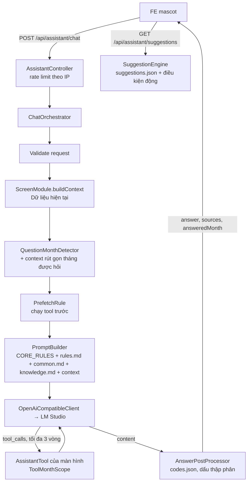

# Trợ lý AI (assistant) – backlog-be

Tài liệu kỹ thuật cho module trợ lý AI (mascot) trả lời câu hỏi theo màn hình FE. Hiện có: Cost Monitoring.
Quy ước ngắn cho AI coding agent: [CLAUDE.md](../../CLAUDE.md).

## Mục lục

1. [Tổng quan](#1-tổng-quan)
2. [Hạ tầng LLM](#2-hạ-tầng-llm)
3. [Cấu trúc thư mục](#3-cấu-trúc-thư-mục)
4. [Cách AI "biết" dữ liệu](#4-cách-ai-biết-dữ-liệu)
5. [Cost Monitoring](#5-cost-monitoring)
6. [API](#6-api)
7. [Hậu xử lý câu trả lời](#7-hậu-xử-lý-câu-trả-lời)
8. [Hướng dẫn thêm màn hình mới](#8-hướng-dẫn-thêm-màn-hình-mới)
9. [Sửa hành vi AI không cần sửa code](#9-sửa-hành-vi-ai-không-cần-sửa-code)
10. [Kiểm tra chất lượng](#10-kiểm-tra-chất-lượng)
11. [Giới hạn hiện tại](#11-giới-hạn-hiện-tại)
12. [Lịch sử thay đổi](#12-lịch-sử-thay-đổi)

---

## 1. Tổng quan

- FE gửi câu hỏi kèm `screenKey` (màn hình đang mở) và tham số màn hình. BE dựng context từ dữ liệu thật,
  gọi LLM nội bộ (LM Studio, API OpenAI-compatible) có tool calling, hậu xử lý rồi trả câu trả lời.
- Tách **lõi** (`assistant/core`, không chứa từ khóa nghiệp vụ) và **màn hình** (`assistant/screens/*` +
  `resources/assistant/screens/{screenKey}`). Màn hình đăng ký qua interface `ScreenModule`; `ScreenRegistry` tự gom các bean.
- Kết luận (vượt / trong target, tiến độ, dự báo, rủi ro…) **tính bằng code** (lớp `*Assessment`), model chỉ diễn đạt lại.
  Kết quả tool dạng `Nhãn=giá trị`, nhãn theo ngôn ngữ, không lộ mã nội bộ.
- Ngôn ngữ trả lời: `vi` (mặc định) hoặc `en`.



## 2. Hạ tầng LLM

**LM Studio** (máy chủ nội bộ, API OpenAI-compatible, không dùng API key):

| Thiết lập | Giá trị | Ghi chú |
|---|---|---|
| Model | `openai/gpt-oss-20b` | Mặc định trong `AssistantProperties` |
| Context Length | 16384 | Prompt + lịch sử + kết quả tool + câu trả lời phải nằm trong giới hạn này |
| Idle TTL | (cần xác nhận) | Model bị unload khi rảnh lâu → lần gọi đầu chậm hơn |
| Parallel | (cần xác nhận) | Nên ≥ `assistant.llm.max-concurrent` để các câu hỏi đồng thời không phải xếp hàng trong LM Studio |

**Cấu hình `assistant.llm.*`** (`application.properties`, lớp `AssistantProperties`). Khi sửa, chỉ thay đúng dòng `assistant.*`.

| Key | Ý nghĩa |
|---|---|
| `assistant.llm.base-url` | URL API OpenAI-compatible, không có `/` cuối |
| `assistant.llm.model` | Tên model trên LM Studio |
| `assistant.llm.timeout-seconds` | Timeout đọc mỗi lần gọi LLM (mặc định 180; connect cố định 5 giây) |
| `assistant.llm.max-tokens` | Số token tối đa của câu trả lời, gồm cả token reasoning (mặc định 3000) |
| `assistant.llm.temperature` | Mặc định 0.2 |
| `assistant.llm.max-concurrent` | Số câu hỏi xử lý đồng thời (mặc định 4); vượt → 503 `LLM_BUSY` |
| `assistant.llm.reasoning-effort` | Có giá trị thì gửi `reasoning_effort`; trống (mặc định) → dùng dòng `Reasoning:` trong prompt |

**Giới hạn khi chạy:**

- **Đồng thời**: `LlmConcurrencyLimiter` (Semaphore). Một câu hỏi giữ 1 suất cho cả vòng tool calling; đầy thì trả 503 ngay, không chờ.
- **Timeout tổng**: 170 giây cho một câu hỏi (mọi lần gọi LLM + tool). Còn dưới 1 giây thì dừng, trả 503 `LLM_ERROR`.
- **Rate limit**: `/chat` 10 request / 60 giây / IP (`remoteAddr`, không tin `X-Forwarded-For`), lưu trong bộ nhớ từng instance.
- **Tool calling**: tối đa 3 vòng.
- **Reasoning**: `Reasoning: low` mặc định; `medium` khi câu hỏi có "đánh giá", "phân tích", "vì sao", "so sánh" (có dấu / không dấu).
- HTTP client ép HTTP/1.1, không streaming; chỉ lấy `message.content`, bỏ phần reasoning / `<think>`.

## 3. Cấu trúc thư mục

```
src/main/java/com/example/backlogbe/assistant/
├── core/
│   ├── api/          AssistantController, AssistantExceptionHandler, AssistantRateLimiter, dto/
│   ├── chat/         ChatOrchestrator (luồng chính)
│   ├── llm/          LlmClient, OpenAiCompatibleClient, LlmConcurrencyLimiter, các Llm*Exception
│   ├── prompt/       PromptBuilder
│   ├── tool/         AssistantTool (interface tool)
│   ├── prefetch/     PrefetchRule (interface)
│   ├── postprocess/  AnswerPostProcessor
│   ├── suggestion/   SuggestionEngine, SuggestionCondition, SuggestionFile
│   ├── month/        QuestionMonthDetector, ToolMonthScope
│   ├── screen/       ScreenModule, ScreenRegistry, ParamSpec
│   ├── config/       AssistantProperties (assistant.llm.*)
│   └── eval/         AssistantEvalController, AssistantEvalService, EvalCase/Report/Result (profile dev)
└── screens/
    ├── costmonitoring/  CostMonitoringModule, ContextProvider, Assessment, Snapshot(+Loader), CmText,
    │                    5 tool, RatioTrendPrefetchRule, SuggestionConditions, ToolArgs, dto/, repository/
    └── _template/       TemplateModule, TemplateContextProvider, ExampleTool (mẫu, không @Component)

src/main/resources/assistant/
├── core/common.md                 kiến thức chung, nối vào system prompt
└── screens/
    ├── <screenKey>/               vd cost-monitoring/: knowledge.md, rules.md, codes.json, suggestions.json, eval.json
    └── _template/                 mẫu + README.md mô tả từng file (không bao giờ được đọc khi chạy)
```

## 4. Cách AI "biết" dữ liệu

- **Không fine-tune.** Model dùng nguyên bản; mọi hiểu biết về màn hình đến từ prompt và tool ở mỗi câu hỏi.
- **System prompt** (`PromptBuilder`), theo thứ tự:
  chỉ định ngôn ngữ + `Reasoning:` + quy tắc chung (CORE_RULES trong code) + `rules.md`
  + `core/common.md` + `knowledge.md` + `Dữ liệu hiện tại:` + context của màn hình.
  User message = câu hỏi (+ câu nhắc, vd tháng được hỏi; `vi` thêm "(Trả lời bằng tiếng Việt.)").
- **Context**: `ScreenModule.buildContext(params, lang)` lấy số liệu đúng như màn hình FE đang hiển thị.
- **Assessment tính sẵn kết luận**: vd `CostMonitoringAssessment` tính tiến độ, dự báo, rủi ro, kịch bản cuối tháng
  và đưa vào context/tool dưới dạng nhãn ("Kết luận dự báo=…", "Rủi ro=…"). Model không phải tự so sánh số.
- **Tool calling**: model gọi tool khi cần chi tiết (theo ngày, top vật tư, tháng trước…). Kết quả tool được giới hạn độ dài
  (`AssistantTool.maxResultLength`). Tool đã chạy thành công được trả về trong `sources`.
- **Prefetch**: `PrefetchRule` chạy tool trước khi gọi LLM cho loại câu hỏi đã biết (model nhỏ hay quên gọi tool),
  kết quả nối vào cuối context. Không pre-fetch được thì thêm câu nhắc model tự gọi tool.
- **Hỏi tháng khác** (màn hình có `supportsMonthQuestions() = true`):
  - `QuestionMonthDetector` dò tháng trong câu hỏi ("tháng 10", "T10/2026", "2026-10", "october 2026"…).
    `MonthPlan` chọn tối đa 2 tháng khác tháng đang xem, trong 24 tháng gần nhất, không vượt tháng hiện tại.
  - Mỗi tháng đó được nối thêm context rút gọn (`buildCompactContext`).
  - Tool có tham số tùy chọn `month`; `ToolMonthScope` chỉ cho phép tháng đang xem hoặc tháng đã dựng context,
    params đổi qua `ScreenModule.paramsForMonth`. Tháng khác → lỗi `invalid_argument` trả cho model.
  - Response có `answeredMonth` khi câu trả lời dùng dữ liệu tháng khác. Không dựng được (ngoài phạm vi) → câu nhắc người dùng đổi tháng.

## 5. Cost Monitoring

`screenKey = cost-monitoring`. Params: `month` (`yyyy-MM` | `yyyy.MM`, trống = tháng hiện tại),
`simuWeek` / `plTgtMode` (`Simu_W1..Simu_W5`, trống = tuần mới nhất có số). Lưới 3×3: bộ phận PRESS / MOLD / GUIDE ×
loại chi phí OT / T&SL / RM; mỗi ô là một "khung".

### Nguồn dữ liệu

| Nguồn | Dùng cho |
|---|---|
| `sp_CostMonitoringChart` | Dữ liệu chart theo ngày: FC, PL, Fluct (`fluctTgt`), Actual MTD, Estimate (`Est_MTD`) |
| `fn_CostActualDaily` | Actual theo ngày, gồm phân bổ chi phí chung (`sql/02_fn_cost_actual_daily.sql`); `sp_CostMonitoringChart` gọi hàm này. `CostTopItemsRepository` không gọi hàm mà lặp lại cùng bộ lọc trên `CostTool` / `CostRm`, chỉ lấy cost center trực tiếp |
| `F2_PL_TGT` | PL simulation theo tuần (`Simu_W1..W5`) |
| `F2_Working_Date` | Lịch làm việc (`WD_All`, `WD_Office`), Ratio theo ngày (`Adj_Ratio_PR/_MO/_GU`, `Adj_Ratio_KVH`) |
| `CostTool` | Chi tiết xuất vật tư T&SL (vật tư, cost center, máy) |
| `CostRm` | Chi tiết xuất vật tư RM |

### Công thức

D = ngày dữ liệu hiện tại, N = số ngày trong tháng.

- **Fluct** (Fluctuating TGT, target chính) = FC × (1 + Ratio).
- **Ratio** = (Sale&Inven +/-) / Doanh số FC cả tháng của bộ phận;
  Sale&Inven +/- = (Doanh số thực tế MTD − Doanh số FC MTD) + (Tồn kho hiện tại − Tồn kho đầu tháng).
  Cùng một Ratio cho OT, T&SL, RM của một bộ phận. Ngày chưa tới dùng Ratio của hôm qua.
- **Estimate** = Actual + phần PL các ngày còn lại, phân bổ theo `WD_All` (ngày nghỉ nhà máy không cộng). Không có PL thì không có Estimate.
- **Badge** = Actual / Fluct × 100 ("OK x%" / "Vượt x%"). **Tiến độ chuẩn** = D / N × 100.
- **Dự báo cuối tháng**: có PL → Estimate ngày cuối tháng; không PL → Actual + Fluct / N × (N − D).
  Dự báo > Fluct → "Dự báo vượt Fluct".
- **Rủi ro**: HIGH khi đã vượt hoặc dự báo vượt; WATCH khi chi nhanh hơn tiến độ (> 3 điểm %) nhưng dự báo trong Fluct; còn lại OK.
- **Kịch bản cuối tháng**:
  "Nếu từ nay chi đúng target" = Actual + Fluct / N × (N − D);
  "Nếu giữ tốc độ hiện tại" = Actual / D × N;
  "Ngân sách còn lại mỗi ngày" = (Fluct − Actual) / (N − D); "Nhịp target mỗi ngày" = Fluct / N.
- Tháng đã kết thúc: không tính tiến độ / dự báo / kịch bản; thay bằng "Kết quả tháng" = Actual − Fluct.
- Mọi phần chênh hiển thị tính từ số đã làm tròn 1 chữ số (K$), để khớp phép trừ người dùng tự làm trên màn hình.

Chi tiết: comment đầu `CostMonitoringAssessment` và `knowledge.md`.

### Tool

Thứ tự gửi cho LLM giữ như bảng. Mọi tool có tham số tùy chọn `month`.

| Tool | Tham số | Trả về (tóm tắt) |
|---|---|---|
| `get_daily_series` | `div`, `cost` | Chuỗi theo ngày từ ngày 1 đến D: ngày nghỉ, chi trong ngày, Actual cộng dồn, Fluct trong ngày, Fluct theo tiến độ, % đã dùng, % thời gian. |
| `get_top_items` | `div`, `cost` (T&SL, RM), `limit` | Top vật tư, top cost center, top máy (K$ 2 chữ số) + tổng; chỉ cost center trực tiếp, chưa gồm phân bổ. |
| `compare_previous_month` | `div`, `cost` | Tháng trước: FC, Fluct, Act cuối tháng, Act cùng kỳ (ngày D), kèm số tháng này. |
| `explain_variance` | `div` (thêm `ALL`), `cost` | Giải thích chênh lệch, tính sẵn: chế độ IN_PROGRESS / OVER / CLOSED_WITHIN, tiến độ, dự báo, rủi ro, kịch bản, top ngày / vật tư, so cùng kỳ (RM, T&SL). |
| `get_ratio_trend` | `div` | Ratio theo ngày (bộ phận + KVH), Fluct theo ngày, tóm tắt đầu / cuối, ngày đổi chiều, ngày tăng / giảm mạnh nhất. |

Pre-fetch: `RatioTrendPrefetchRule` chạy `get_ratio_trend` khi câu hỏi về xu hướng Fluct ("fluct" + vì sao / tăng / giảm…);
`div` rút từ câu hỏi, không nhắc bộ phận → chạy cả PRESS, MOLD, GUIDE.

### Điều kiện gợi ý động (`CostMonitoringSuggestionConditions`)

| `when` | Điều kiện | Ưu tiên |
|---|---|---|
| `over` | Actual > Fluct | tier 0, weight = Actual − Fluct |
| `forecast_over` | Chưa vượt, dự báo cuối tháng > Fluct | tier 1, weight = phần dự báo vượt |
| `watch` | Rủi ro "Cần theo dõi" | tier 2, weight = Pct − Pace |
| `no_actual` | Khung chưa có Actual | tier 3 |
| `no_pl` | Tháng chưa có PL simulation (không có `{div}` / `{cost}`) | tier 3 |
| `fluct_below_fc` / `fluct_above_fc` | \|Fluct / FC − 1\| ≥ 3% (chỉ `{div}`) | tier 3, weight = \|Fluct / FC − 1\| |

Tối đa 2 câu động, mỗi khung tối đa 1 câu; phần còn lại là câu tĩnh. Greeting đếm số khung `over` / `forecast_over`.

## 6. API

Không yêu cầu token (giống các API hiện có), `@CrossOrigin(*)`.

### `POST /api/assistant/chat`

```json
{
  "screenKey": "cost-monitoring",
  "params": { "month": "2026-11", "simuWeek": "Simu_W2" },
  "question": "Vì sao PRESS RM vượt target?",
  "history": [ { "role": "user", "content": "..." }, { "role": "assistant", "content": "..." } ],
  "lang": "vi"
}
```

```json
{
  "answer": "...",
  "sources": [ { "tool": "explain_variance", "div": "PRESS", "cost": "RM", "month": "2026-11" } ],
  "answeredMonth": "2026-10"
}
```

- Giới hạn: câu hỏi ≤ 2000 ký tự; `history` giữ 6 lượt cuối, mỗi lượt ≤ 4000 ký tự; ≤ 20 params, mỗi giá trị ≤ 100 ký tự;
  `screenKey` dạng `^[a-z0-9-]{1,50}$`; `lang` = `vi` | `en`.
- `sources`: tool đã gọi thành công, không trùng (khác `month` = phần tử khác), theo thứ tự gọi (pre-fetch trước).
- `answeredMonth`: chỉ có khi câu trả lời dùng dữ liệu tháng khác tháng đang xem.

### `GET /api/assistant/suggestions`

`?screenKey=cost-monitoring&month=2026-11&lang=vi&count=4&exclude=...&exclude=...`

```json
{
  "greeting": "...",
  "suggestions": [ { "text": "Vì sao PRESS RM vượt target?", "kind": "dynamic" }, { "text": "...", "kind": "static" } ]
}
```

Không gọi LLM, không rate limit. Tham số màn hình lấy đúng theo `ScreenModule.paramSpec()`. `screenKey` không có file gợi ý → `suggestions: []`.

### `POST /api/assistant/eval?screenKey=<key>`

Chỉ có ở profile `dev` (profile khác → 404). Xem [mục 10](#10-kiểm-tra-chất-lượng).

### Mã lỗi

Body: `{ "status", "code", "message" }`.

| HTTP | code | Khi nào |
|---|---|---|
| 400 | `BAD_REQUEST` | Validate / body sai, tham số màn hình sai |
| 429 | `RATE_LIMITED` | Vượt 10 request/phút/IP (`/chat`), kèm `Retry-After` |
| 503 | `LLM_BUSY` | Vượt `assistant.llm.max-concurrent` |
| 503 | `LLM_TRUNCATED` | Content rỗng, `finish_reason=length` |
| 503 | `LLM_EMPTY` | Content rỗng, lý do khác |
| 503 | `LLM_ERROR` | LLM lỗi HTTP / timeout / không kết nối / quá 170 giây |
| 500 | `INTERNAL` | Lỗi khác (vd SQL khi lấy context) |

## 7. Hậu xử lý câu trả lời

`AnswerPostProcessor`, chạy cho mọi màn hình:

1. **Thay mã nội bộ** còn sót theo `resources/assistant/screens/{screenKey}/codes.json`
   (`{ "MA": { "vi": "nhãn", "en": "label" } }`). Chỉ thay khi mã là từ đứng riêng; thứ tự trong file = thứ tự thay.
   Có thay thì log WARN kèm danh sách mã (dấu hiệu nên sửa `knowledge.md` / `rules.md`).
2. **Dấu thập phân** (`lang = vi`): cụm "số,số" có đúng 1 dấu phẩy → dấu chấm (`5,5` → `5.5`, `175,2` → `175.2`, `0,500` → `0.500`).
   Giữ nguyên: `1,234,567` (nhiều nhóm nghìn); `1,234` / `175,234` (1–3 chữ số + đúng 3 chữ số, không bắt đầu bằng 0 → coi là
   phân cách nghìn); `5, 6` (có khoảng trắng sau dấu phẩy).
3. **Ngoại lệ "ngày 5,6"**: ngay sau "ngày" / "ngay" / "day" / "days" (bỏ qua khoảng trắng) thì `5,6` là danh sách ngày, giữ nguyên dấu phẩy.

## 8. Hướng dẫn thêm màn hình mới

Ví dụ `screenKey = machine-monitor`.

### Phía BE

1. **Java**: sao chép `assistant/screens/_template/` → `assistant/screens/machinemonitor/`, đổi package và tên lớp
   (`TemplateModule`, `TemplateContextProvider`, `ExampleTool`).
2. **Resources**: sao chép `resources/assistant/screens/_template/` → `resources/assistant/screens/machine-monitor/`
   (tên thư mục = `screenKey`).
3. Trong module: đổi `SCREEN_KEY`, khai báo `paramSpec()`, viết `buildContext` (gọi service sẵn có, không query DB riêng
   nếu đã có service). Nếu màn hình có tháng: `supportsMonthQuestions()`, `buildCompactContext`, `paramsForMonth`.
4. Viết tool (`AssistantTool`): kết quả `Nhãn=giá trị`, số có dấu khi là chênh lệch, nhãn theo `lang`, không lộ mã nội bộ;
   kết luận so sánh đặt trong lớp Assessment riêng. Thêm `PrefetchRule` nếu cần.
5. Thêm `@Component` cho module, tool, prefetch rule (lớp mẫu cố ý không có).
6. Viết `knowledge.md`, `rules.md`, `codes.json`, `suggestions.json` (+ `suggestionConditions` / `suggestionGreeting` nếu có câu động), `eval.json`.
7. Chạy eval (profile dev) khi được yêu cầu: `POST /api/assistant/eval?screenKey=machine-monitor`.
8. Không thêm từ khóa nghiệp vụ vào `core/`. Cập nhật tài liệu này ([mục 5](#5-cost-monitoring), [mục 12](#12-lịch-sử-thay-đổi)).

### Phía FE (repo FE, chi tiết cần xác nhận)

1. Khai báo route của màn hình → `screenKey` trong `mascotMessages.ts` (cùng giá trị với `SCREEN_KEY` của BE).
2. Trong màn hình, dùng `useMascotParams` để gửi tham số màn hình (đúng tên trong `paramSpec()`, vd `month`) cho `/chat` và `/suggestions`.
3. Tùy chọn: màn hình có khái niệm tháng thì dùng `useMascotMonthControl` để mascot đổi tháng đang xem
   (vd khi response có `answeredMonth` hoặc gợi ý đổi tháng). (cần xác nhận hành vi cụ thể)

### Checklist

- [ ] `SCREEN_KEY` BE = `screenKey` FE = tên thư mục resources.
- [ ] `paramSpec()` khớp tên tham số FE gửi; log không có WARN `unknown=` / `invalidFormat=`.
- [ ] Module, tool, prefetch rule có `@Component`; log khởi động `Assistant screens registered` có `screenKey` mới.
- [ ] Log khởi động `prompt texts loaded`, `suggestions loaded` có `screenKey` mới.
- [ ] Tool trả `Nhãn=giá trị`, không có mã nội bộ; mã có thể lọt ra đã có trong `codes.json`.
- [ ] `eval.json` có ít nhất các câu hỏi chính; chạy eval pass (khi được yêu cầu).
- [ ] Cập nhật mục 5 (nếu là màn hình có tool riêng, thêm mục con) và mục 12 của tài liệu này.

## 9. Sửa hành vi AI không cần sửa code

Phần lớn lỗi trả lời sửa được bằng văn bản trong `resources/assistant/screens/{screenKey}/`, rồi **restart** BE
(các file chỉ đọc và cache khi khởi động):

| Muốn | Sửa |
|---|---|
| Model hiểu sai khái niệm, công thức, nhãn | `knowledge.md` |
| Model vi phạm cách trả lời (độ dài, cách gọi tool, cách nói số) | `rules.md` (mỗi dòng `- ...`) |
| Mã nội bộ lọt ra câu trả lời | `codes.json` |
| Câu gợi ý tĩnh / mẫu câu động | `suggestions.json` |
| Thêm câu kiểm tra hồi quy | `eval.json` |

Kiến thức dùng chung mọi màn hình: `resources/assistant/core/common.md`. Quy tắc chung (CORE_RULES) nằm trong `PromptBuilder` – sửa là sửa code.

**Mẹo viết `knowledge.md` cho model nhỏ (20B):**

- Thêm **ví dụ hỏi–đáp** ngắn cho các câu hay hỏi; model bắt chước ví dụ tốt hơn làm theo mô tả.
- **Tránh tên bảng / SP / cột DB**; dùng đúng nhãn mà context / tool gửi (vd "Badge=…", "Chi vượt tiến độ=…").
- Giải thích công thức kèm **số minh họa** (vd "FC = 100, Ratio = −5% → Fluct = 95").
- Viết khẳng định ngắn, mỗi ý một dòng; nói rõ điều chưa có dữ liệu để model không suy đoán.
- Không lặp quy tắc chung đã có trong lõi; quy tắc trùng hoặc mâu thuẫn làm model khó làm theo.

## 10. Kiểm tra chất lượng

### Eval

- `resources/assistant/screens/{screenKey}/eval.json`: `[{ question, month, mustContain, mustNotContain }]`.
- `POST /api/assistant/eval?screenKey=<key>` (chỉ profile `dev`) gọi LLM thật, trả bảng pass/fail kèm câu trả lời.
  Kết quả phụ thuộc LLM nên có thể dao động giữa các lần chạy.

### Log cần xem

Log không ghi câu hỏi, câu trả lời, params, tham số tool. Kết quả tool chỉ log DEBUG ở profile `dev`.

| Log | Xem gì |
|---|---|
| `LLM call: finish_reason=… promptTokens=… completionTokens=… toolCalls=… durationMs=…` | Từng lần gọi LLM: `length` = hết token; `promptTokens` gần Context Length = context bị cắt |
| `Assistant tool: name=… round=… outcome=… durationMs=…` | Tool nào được gọi, ở vòng nào (`round=0` = pre-fetch), thành công hay lỗi |
| `Assistant chat screenKey=… ok=… llmCalls=… extraMonths=… promptTokens=… durationMs=…` | Tổng kết một câu hỏi |
| `tool round limit reached` / `total time limit reached` | Chạm giới hạn 3 vòng tool / 170 giây |
| `replaced internal codes in answer` | Mã nội bộ lọt ra, cần sửa `knowledge.md` / `rules.md` |

### Lỗi thường gặp

| Hiện tượng | Nguyên nhân | Cách xử lý |
|---|---|---|
| Gọi LLM treo đến timeout | JDK HttpClient thử nâng cấp HTTP/2 (h2c), LM Studio xử lý sai | Client đã ép HTTP/1.1; nếu đổi client phải giữ HTTP/1.1 |
| 503 `LLM_TRUNCATED` / content rỗng | Model dùng hết `max-tokens` cho reasoning | Giữ `Reasoning: low` cho câu đơn giản; tăng `assistant.llm.max-tokens`; rút gọn context |
| Trả lời tiếng Anh khi `lang = vi` | Model nhỏ bị kéo theo ngôn ngữ của context / tool | Đã có câu chỉ định ngôn ngữ ở đầu, cuối system prompt và cuối câu hỏi; thêm ví dụ tiếng Việt trong `knowledge.md` |
| Bịa số khi chưa gọi tool | Model trả lời từ trí nhớ thay vì gọi tool | (đề xuất) Thêm quy tắc "chưa có số thì gọi tool" trong `rules.md`; thêm `PrefetchRule` cho loại câu hỏi đó; kiểm tra `sources` |
| Thiếu ý / bỏ dữ liệu cuối context | Prompt vượt Context Length 16384 (xem `promptTokens`) | (đề xuất) Rút gọn `knowledge.md`, giảm `history`, giới hạn `maxResultLength` của tool; đặt phần quan trọng trước trong kết quả tool |

## 11. Giới hạn hiện tại

- **OT chưa có actual**: chỉ có FC, PL, Fluct, Estimate; không có chi tiết vật tư.
- **Chưa có doanh số / tồn kho chi tiết**: chỉ có Ratio; không giải thích được Ratio đổi do doanh số hay tồn kho.
- **Endpoint public**: `/api/assistant/*` không yêu cầu token, `@CrossOrigin(*)`; chỉ có rate limit theo IP (trong bộ nhớ, mỗi instance tính riêng).
- **Model 20B yếu suy luận nhiều bước**: vì vậy kết luận được tính sẵn bằng code; câu hỏi cần kết hợp nhiều tool / nhiều tháng dễ sai hơn.
- `get_top_items` chỉ tính cost center trực tiếp, chưa gồm chi phí chung phân bổ.
- Dò tháng: "T2".."T7" không kèm năm bị bỏ qua (trùng thứ trong tuần); "may" chỉ nhận khi kèm năm.
- **TODO `div` / `cost` → `tags`**: `AssistantSource` (`sources` trong response), `SuggestionCondition` và placeholder
  `{div}` / `{cost}` trong `suggestions.json` vẫn mang khái niệm của Cost Monitoring. Đổi thành `tags` chung khi có màn hình thứ hai
  (ảnh hưởng hợp đồng API với FE).

## 12. Lịch sử thay đổi

| Ngày | Thay đổi |
|---|---|
| 2026-11-07 | Tạo tài liệu: kiến trúc sau tái cấu trúc core / screens, hướng dẫn thêm màn hình mới. Cost Monitoring có 5 tool: `get_daily_series`, `get_top_items`, `compare_previous_month`, `explain_variance`, `get_ratio_trend`. |
| 2026-11-07 | Sắp xếp lại theo 12 mục: thêm hạ tầng LLM, cách AI "biết" dữ liệu, nguồn dữ liệu và công thức Cost Monitoring, hậu xử lý, phía FE khi thêm màn hình, sửa hành vi không cần code, log và lỗi thường gặp. |
